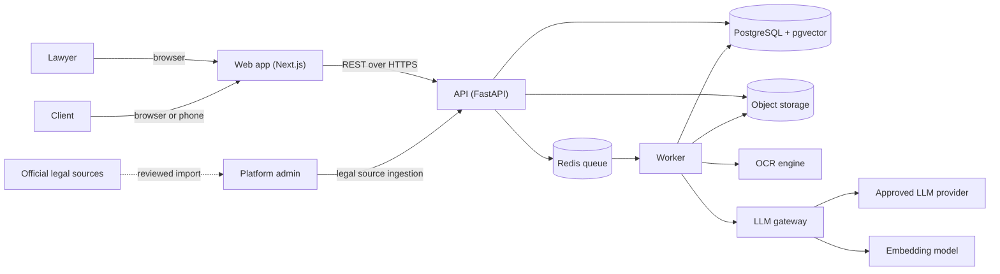
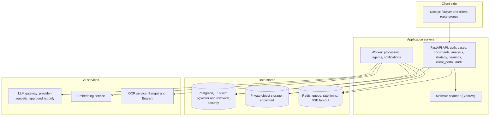
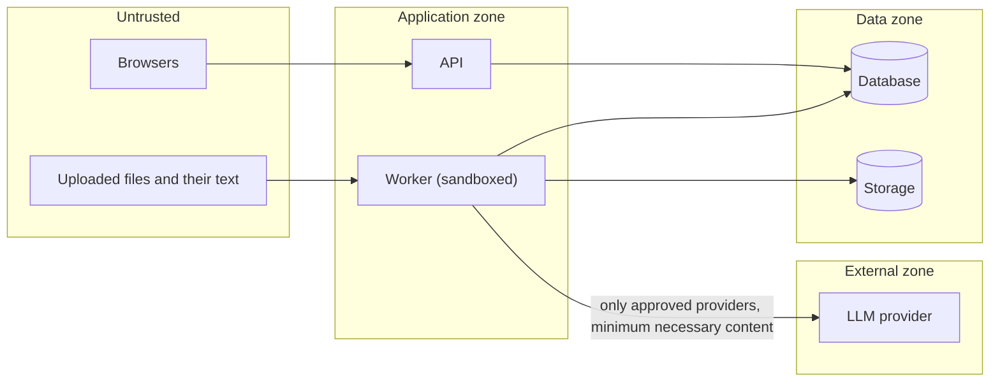
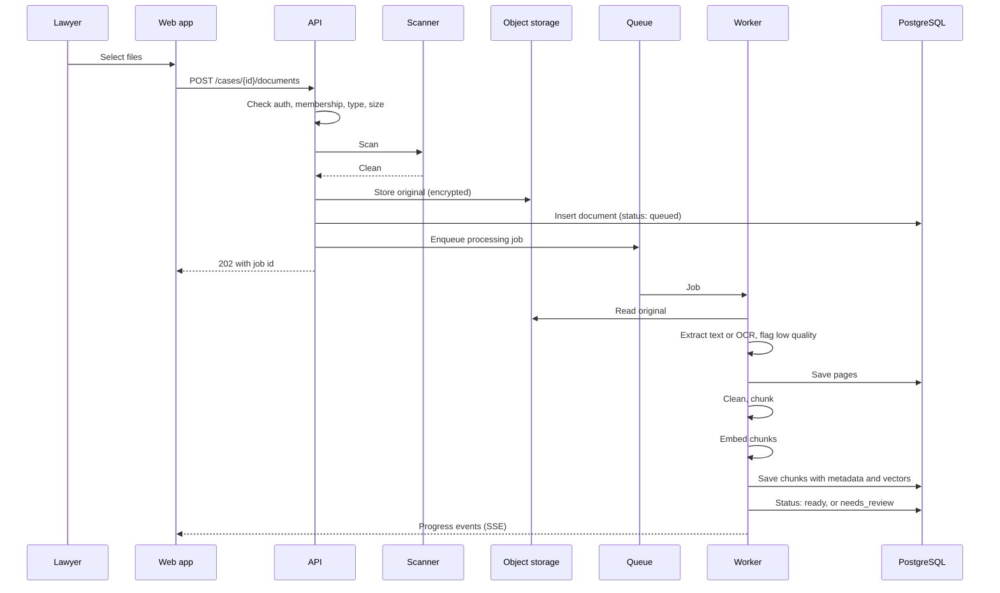
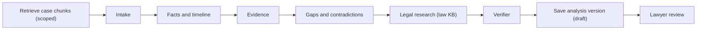
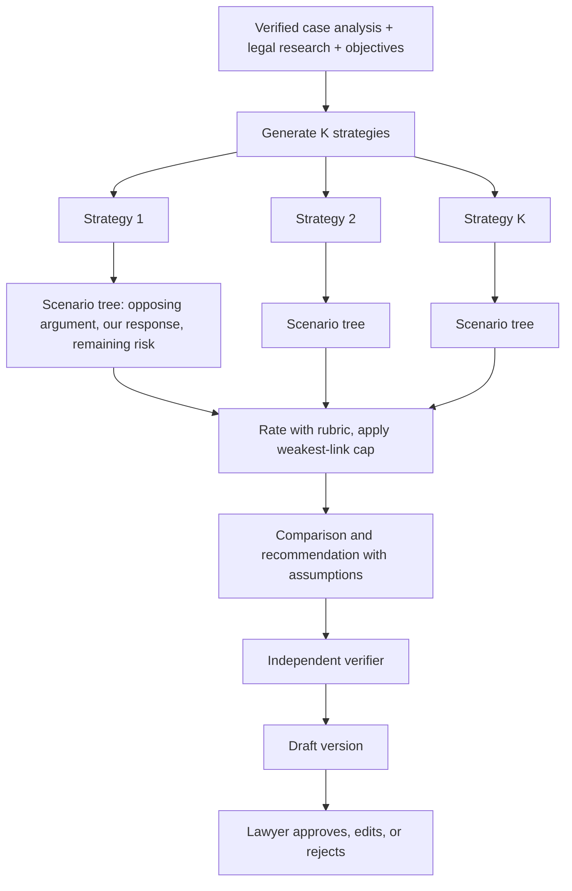
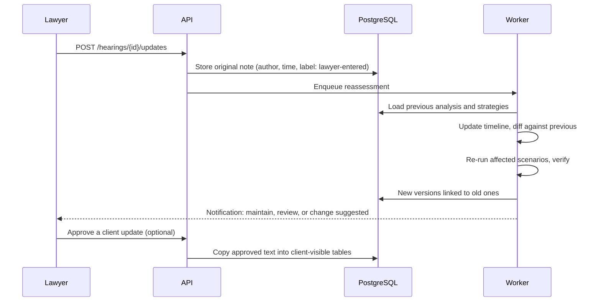
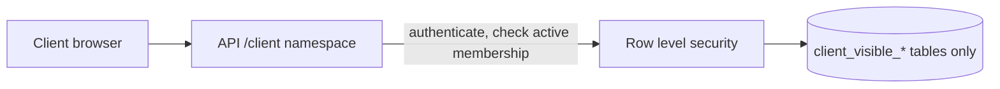
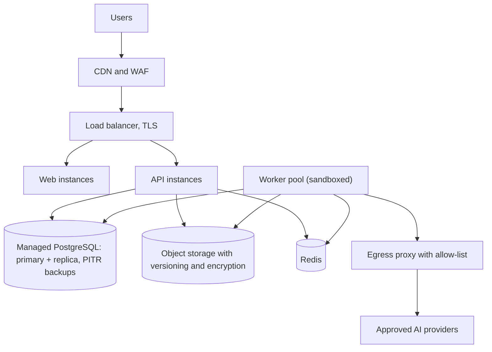

# System Architecture

Status: Draft 1. Diagrams use Mermaid and render in GitHub and most Markdown viewers.

## 1. Overview

One web application and one backend serve two roles. A Next.js frontend talks to a FastAPI backend over REST. PostgreSQL (with pgvector) holds relational data, permissions, and vectors. Object storage holds original files. A worker runs slow jobs (OCR, embeddings, AI runs). An LLM gateway calls approved model providers.

## 2. Context diagram

## 3. Container view

### Component responsibilities

| Component | Responsibility | Notes |
|---|---|---|
| Next.js web app | UI, role-based layouts, server-side session check, generated API client | Never holds provider keys. Role is decided by the server |
| FastAPI API | Authentication, authorization, business rules, job creation, pre-signed URLs, audit | Stateless; scales horizontally |
| Worker | Document processing, embeddings, agent runs, notification fan-out | Runs in a sandbox, no direct internet except the LLM gateway |
| PostgreSQL | Source of truth for records, permissions, versions, vectors, audit | Row level security enabled on all case tables |
| Object storage | Original files and derived images | Private buckets, encryption, no public access |
| Redis | Job queue, rate limiting, progress events | No case content stored |
| OCR service | Page images to text with confidence | Runs locally by default |
| LLM gateway | Single entry for model calls with approved-provider check, schema validation, run logging | Mock provider for tests |
| ClamAV | Scans uploads before processing | Quarantine on detection |

## 3.1 Trust boundaries

Rules at each boundary:
- Browser to API: authentication, CSRF protection, rate limits, input validation.
- File to worker: treated as hostile; scanned, converted in a sandbox, text treated as data in prompts.
- App to data: least-privilege database roles; row level security; no direct database access from the web app.
- Worker to LLM provider: only providers on the approved list; only the retrieved passages needed for the task.

## 4. Data flows

### 4.1 Document ingestion and RAG indexing

### 4.2 Case analysis

### 4.3 Strategy engine

### 4.4 Hearing update and reassessment

### 4.5 Client portal read path

The client namespace has no code path to lawyer tables.

## 5. Multi-tenancy and isolation

- Each lawyer or chamber is an `organization`. Every case belongs to one organization.
- Every row in a case-scoped table carries `case_id` and `organization_id`.
- Row level security policies check membership through `case_members`.
- Vector and text queries include `case_id` in SQL.
- Object keys follow `org/{org_id}/case/{case_id}/doc/{doc_id}/{version}`, and access goes through pre-signed URLs issued after a membership check.
- Cross-case tests run in CI (see `TRD.md` section 14).

## 6. Deployment

### 6.1 Demo deployment (Congress)

A single virtual machine or small cluster running Docker Compose: web, API, worker, PostgreSQL, Redis, MinIO, ClamAV, reverse proxy with TLS. Use synthetic or consented data only.

### 6.2 Production deployment (v1)

Hosting location, data residency, and backup region are open questions in `PRD.md` section 11.

## 7. Scaling notes

- API is stateless; add instances.
- Workers scale by queue depth. OCR is the most CPU-heavy step; run it on a separate queue so it cannot starve AI runs.
- PostgreSQL holds vectors. The private chunk table grows with documents; the legal table is much larger but read-mostly. If the legal knowledge base outgrows pgvector comfort, move only the legal retrieval to a dedicated vector store behind the same retrieval interface, and keep private case chunks in PostgreSQL.
- Strategy runs are the most expensive AI work. Use caching of retrieval results per run, token budgets, and partial results.

## 8. Reliability

- Jobs are idempotent and resumable by stage. A failed stage can be retried without redoing earlier stages.
- Each run has a timeout and a partial-result state.
- Backups: database point-in-time recovery, object storage versioning, tested restores on a schedule.
- Graceful degradation: if the LLM provider is down, uploads and extraction still work; analysis jobs wait or fail with a clear message.

## 9. Observability

Logs, metrics, and traces as in `TRD.md` section 12. Dashboards for queue depth, OCR failures, AI cost, verification failures, and authorization denials.

## 10. Architecture decisions

| ID | Decision | Reason | Revisit when |
|---|---|---|---|
| AD-1 | Modular monolith API plus worker, not microservices | Small team, shared transactions, simpler security | Team or load grows a lot |
| AD-2 | PostgreSQL with pgvector, not a separate vector database | Permissions and vectors in one place; same transaction and RLS | Legal KB retrieval latency or size becomes a problem |
| AD-3 | REST with OpenAPI | Resource-shaped data, generated types | A client needs flexible queries |
| AD-4 | Separate client-visible tables | Leak prevention by construction | None expected |
| AD-5 | Fixed agent stage graph with typed outputs | Traceable, testable | Proven need for dynamic planning |
| AD-6 | Qualitative ratings with a rubric, no win probability | No validated outcome dataset | A calibrated model with data exists |
| AD-7 | Provider-agnostic LLM gateway with approved list | Privacy and portability | Provider decision is final |
| AD-8 | Versioned analyses, strategies, and text | Audit and trust | None |
| AD-9 | Original files are the source of truth | Derived text and embeddings can be rebuilt | None |
| AD-10 | Server-side sessions in httpOnly cookies | No tokens in JavaScript, easy revocation | Mobile native app needs token auth |

## 11. Out of scope for this architecture

Court e-filing integration, payments and billing, voice input, native mobile apps, and a public legal research product.
