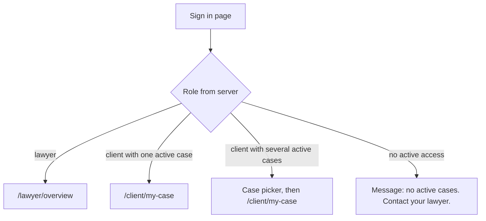
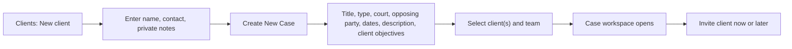
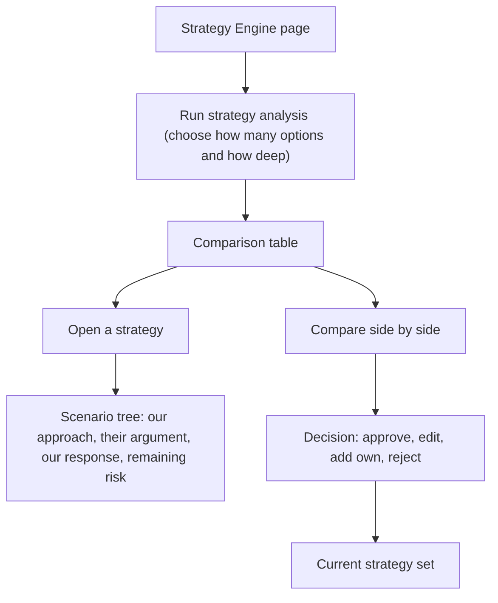
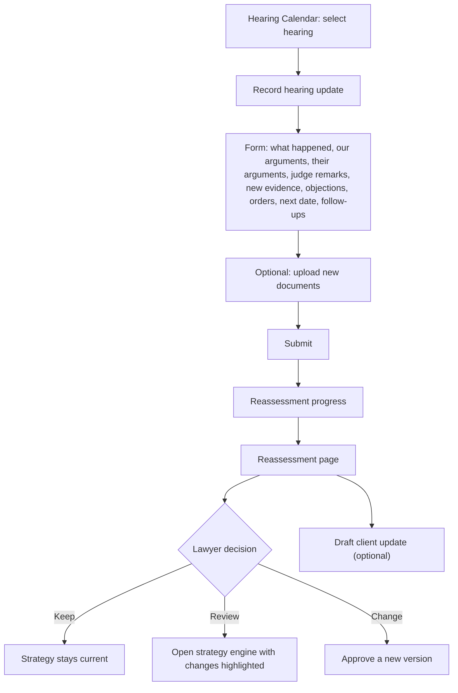

# User Flow

What lawyers and clients see and do, screen by screen. `applicationflow.md` covers what the system does behind each step.

## 1. Principles

1. **One app, two experiences.** The role decides the whole interface. A client never sees a disabled lawyer tool, because those tools are not there.
2. **The lawyer is in charge.** AI output is a draft. Buttons say "Review", "Accept", "Edit", "Reject", never "Apply automatically".
3. **Always show the source.** Any finding links to the document page or the legal source.
4. **Say what kind of statement it is.** Document says, lawyer entered, AI inference, assumption, prediction, unverified.
5. **Admit uncertainty.** "Insufficient information" is shown as a normal result, not an error.
6. **Clients get plain language.** No legal jargon, AI terms, ratings, or strategy.

## 2. Roles and entry points

## 3. Lawyer journeys

### J1. First sign-in
1. Register with name, email, password; set up two-factor (required in v1).
2. Short setup: practice areas, courts, language preference (Bangla or English), chamber name.
3. Land on an empty Overview with three prompts: create a client, create a case, read how the AI works (a one-page note stating what the AI does and does not do).

### J2. Create a client and a case

- The case type pre-fills a stage list the lawyer can edit.
- Client objectives is a text box with the hint "Used by the strategy engine. Only you can see it."
- Inviting a client is optional at creation.

### J3. Upload and review documents
1. In the case, open Documents and drag in files (PDF, DOC, DOCX, JPG, PNG). Multiple files are fine.
2. Each file shows a progress bar: uploading, scanning, extracting, ready.
3. A banner appears when pages need review: "4 pages have low confidence text".
4. Open the document viewer: original on the left, extracted text on the right, flagged pages marked in the page strip.
5. Click a flagged page, fix the text, save. The page shows "Corrected by you".
6. Mark the document as reviewed (optional) and set its type if the AI guessed wrong.

### J4. Review case analysis
1. Click "Analyze case". A progress panel lists the stages (documents, facts and timeline, evidence, gaps, legal research, verification).
2. The AI Case Analysis page opens when the draft is ready:
   - Summary of the client's position as understood.
   - Factual issues and legal issues.
   - Timeline (filterable by source type).
   - Evidence: supports, weakens, unclear.
   - Contradictions (two sources side by side).
   - Missing evidence and questions for the client.
   - Applicable law and relevant judgments, each with status and "last checked" date.
   - Risks and areas needing investigation.
3. Every line has a source chip. Clicking it opens the document at that page or the legal source text.
4. A "Verification" tab lists claims that were removed or flagged unverified, with reasons.
5. The lawyer can accept, edit, or reject each item and mark the whole analysis reviewed.
6. Items to ask the client convert to a client task with one click (still hidden from the client until the lawyer makes it visible).

### J5. Explore strategies

- **Comparison table:** one column per strategy. Rows: legal support, evidence support, resilience to opposing arguments, procedural fit, information completeness, overall. Each cell shows a label (Strong, Moderate, Weak, Insufficient information) and a one-line reason. Expanding a cell shows the full reason and sources.
- **Best supported:** a banner may say "Strategy B appears best supported by the available facts and law" with the assumptions listed and a "What would change this" section. It never shows a percentage.
- **Scenario tree view:** an indented or graphical tree. Each node is tagged Opposing argument, Our response, or Remaining risk. Plausibility tags (Likely, Possible, Unlikely) appear on opposing arguments. Pruned branches can be shown on request with the reason.
- **Opponent Analysis page:** the opposing arguments gathered across strategies, grouped by which documents or facts they target.
- **Every strategy page** shows legal basis, supporting evidence, provisions, precedents, strengths, weaknesses, missing evidence, objections, procedural risks, practical obstacles, consequences, and alternatives.
- **Footer on every AI page:** "AI-generated draft for lawyer review. Scenarios are possibilities, not predictions of what a court or opposing lawyer will do."

### J6. Record a hearing and get a reassessment

- The next hearing date has a checkbox "Confirmed". Unconfirmed dates stay tentative and are not shown to the client.
- The reassessment page opens with a clear banner: **Maintain**, **Review**, or **Change suggested**, followed by the reason.
- Sections: what changed since the last analysis (diff), new risks, new opportunities, new evidence needs, new opposing responses, and affected strategies.
- A version selector lets the lawyer compare any two analysis or strategy versions.
- The original hearing note is shown unchanged, labelled "Entered by [name] on [date]. Lawyer-entered, not a verified court record."

### J7. Control what the client sees
1. In the case, open Client View.
2. The page has a left column (what the client currently sees, as a live preview) and a right column of switches:
   - Status label and stage label.
   - Plain explanation of the current stage.
   - Next confirmed hearing and "client must attend".
   - Tasks for the client.
   - Shared documents.
3. To post an update: Write, or "Draft with AI". The AI draft uses only the fields the lawyer has marked shareable. The lawyer edits it, previews it as the client sees it, and clicks Publish.
4. Published updates can be withdrawn.
5. To share a document: pick it, give it a client-friendly name, confirm. Unsharing removes it.
6. A prominent notice says: "Clients never see internal notes, AI analysis, strategies, or risk ratings."

### J8. Close the case
1. Case menu, "Close case".
2. A confirmation panel lists the effects (client access removed for this case only, documents retained, AI runs disabled, history stays available).
3. The lawyer chooses full removal or read-only for the client if the policy allows, and confirms.
4. The case moves to Closed. The workspace shows a "Closed on [date]" banner. History remains browsable.
5. Reopen is available from the case menu and is audited.

## 4. Lawyer screens

Main navigation, in order. Items marked (case) open inside a case workspace and also have a cross-case view where noted.

| Item | Purpose | Key elements |
|---|---|---|
| Overview | Start of day | Today's hearings, tasks due, cases needing attention (new reassessment, flagged pages, pending reviews), recent activity |
| My Cases | All cases | Filters (status, type, court, client), search, case cards with next hearing and review badges |
| Clients | Client list | Profile, linked cases, invitation status, private notes |
| Create New Case | Case form | See J2 |
| Documents | Cross-case document list and the case document list | Status, language, flagged pages, viewer |
| AI Case Analysis (case) | Reviewed analysis | See J4 |
| Legal Research (case) | Provisions and judgments | Result list with status chips, source viewer, add own source, ask a research question |
| Evidence Analysis (case) | Evidence table | Type, what it shows, which side it favors, authenticity concerns, linked facts and sources |
| Strategy Engine (case) | Strategy comparison and trees | See J5 |
| Opponent Analysis (case) | Opposing arguments | Grouped by target, with our possible responses |
| Hearing Calendar | Hearings across cases | Month and list view, tentative and confirmed marks, record update button |
| Case Timeline (case) | Chronology | Filter by source (document, lawyer, hearing, AI), date certainty marks, gap markers |
| Tasks and Follow-ups | Lawyer and client tasks | Due dates, case links, "visible to client" flag |
| Reports | Printable summaries | Case summary, strategy comparison, hearing history (PDF export). Later release |
| Notifications | Alerts | Reassessment ready, processing finished, client completed a task |
| Account and Security | Settings | Password, two-factor, sessions, language, team members, audit view for own actions |

### Case workspace layout
A case page has a header (title, reference, status, client names, next hearing) and tabs:
Overview, Documents, Timeline, Evidence, Legal Research, Analysis, Strategy, Opponent, Hearings, Client View, Tasks, History.
The History tab shows the audit trail and all analysis and strategy versions.

## 5. Client journeys

### C1. Accept an invitation
1. The client receives a message with a sign-up link. The message names the lawyer but has no case details.
2. The client opens the link, confirms their name, and sets a password.
3. They land on their dashboard.

### C2. Check on the case
1. Sign in.
2. My Case shows: status in plain words, a progress bar built from the lawyer's client labels, the latest update, the next confirmed hearing (if any) with a clear "You need to attend" or "You do not need to attend" line, and tasks waiting for the client.
3. The client can open Lawyer Updates to read published messages, newest first.

### C3. Do a requested task
1. A notification says "Your lawyer has asked for something". The notification has no case detail.
2. In My Tasks the client reads the instruction (plain language) and the due date.
3. The client uploads the requested file, or marks the task done.
4. The lawyer is notified. The uploaded file is visible only to the lawyer unless they choose to share it back.

### C4. Case closed
1. After closure, the closed case no longer appears.
2. If the client has other active cases, those remain.
3. If none remain, the client sees "No active cases. Contact your lawyer if you need access."

## 6. Client screens

| Item | Purpose | Contents |
|---|---|---|
| My Case | Home | Status, short plain explanation, latest update, next hearing, tasks due |
| Case Status | Current stage | Stage name in plain language, short description |
| Case Progress | Timeline of stages | Stages with done, current, and upcoming markers (client labels only) |
| Upcoming Hearing | Date details | Date and time, place, attend or not, anything to bring. Shown only when confirmed |
| My Tasks | Requests | Instruction, due date, upload or mark done |
| Shared Documents | Files | Only documents the lawyer shared, with the lawyer's display names and download |
| Lawyer Updates | Messages | Published updates, newest first |
| Notifications | Alerts | Generic wording, link to the relevant page |
| Account Settings | Personal | Password, language (Bangla or English), contact details |

The client interface has no search across data, no AI features, no analysis pages, no strategy pages, no risk language, and no lawyer notes. It works well on a small phone screen: one column, large touch targets, readable text.

## 7. Visual language

Distinct labels so users always know what they are reading. Use a consistent shape, color, and icon per type, and never rely on color alone (add text and an icon).

| Type | Label | Treatment |
|---|---|---|
| Confirmed information | "Confirmed" or "Verified record" | Solid neutral badge with a check icon |
| Document says | "From document" + source chip | Quoted style with the page link |
| Lawyer-entered note | "Entered by [name]" | Distinct note style with author and date |
| AI-generated analysis | "AI draft" | Subtle tinted panel with an AI icon; footer disclaimer |
| AI inference | "AI inference" | Dashed outline, lists the sources it used |
| Assumption | "Assumption" | Hatched or outlined, with "needs confirmation" |
| Scenario or prediction | "Possible scenario" | Italic label, dotted connector in the tree |
| Unverified | "Unverified" | Warning badge, with reason on hover or tap |
| Low-confidence OCR | "Check this text" | Amber marker on the page and in the text |
| Upcoming date | Date chip with days remaining | Accent color; confirmed and tentative look different |
| Completed task | Check and strike | Muted |
| Risk or unresolved question | "Risk" or "Open question" | Red or orange marker with text |
| Client-approved update | "Shared with client" | Green badge with a person icon, with the publish date |
| Rating | Strong, Moderate, Weak, Insufficient information | Text labels with icons. No numbers, no percentages |

An AI result must never look like a court decision, an official record, or a confirmed legal fact.

## 8. States and messages

| Situation | What the user sees |
|---|---|
| Empty case (no documents) | "Upload documents to start. Analysis and strategy need at least one document." |
| Processing | Per-document progress with stage names; the user can leave the page and come back |
| Needs review | Banner with a count and a link to flagged pages |
| AI run in progress | Stage list with live status and an estimated wait; cancel button |
| Partial result | Banner: "This run stopped early. Not explored: [list]. Re-run or continue." |
| Insufficient information | Neutral panel: "Not enough information to assess this. Missing: [list]." |
| Source cannot be verified | Warning chip and explanation; item is excluded from summaries by default |
| Analysis out of date | Banner: "Based on earlier text or documents. Re-run to update." |
| No permission | Short message for lawyers ("You do not have permission to do this in this case"); for clients and unknown items a generic not-found page |
| Provider unavailable | "The AI service is not available. Your documents and notes are safe. Try again later." |
| Session expired | Return to sign-in, keeping the page to return to (no case details in the URL query) |

## 9. Language and accessibility

- Interface and content support Bangla and English. Users set a preferred language; documents keep their own language.
- A font with full Bangla coverage; test conjuncts and long words; correct line breaking.
- Bangla and English numerals are both supported in dates and numbers; dates show in an unambiguous format with the month spelled out.
- Time zone is Asia/Dhaka in the interface; stored in UTC.
- Keyboard navigation for all lawyer screens; visible focus states.
- Contrast that meets common accessibility guidance; text scales without breaking layout.
- Screen reader labels for badges, source chips, and tree nodes.
- Client views are designed for phones first.

## 10. Demo script for the AI Builders Congress

A suggested five to seven minute path through the product (see `PRD.md` section 6.2). Use synthetic or consented data only.

1. **Sign in as the lawyer.** Overview is empty. Create a client and a case (30 seconds).
2. **Upload a mixed bundle:** a digital PDF, a photographed page, and a scanned page, in Bangla and English. Show progress. Open a flagged page, fix a line, show the side-by-side viewer.
3. **Run the analysis.** Show the timeline, one contradiction with both sources, one missing-document prompt, and the source chips opening exact pages.
4. **Legal research.** Show provisions with status and last-checked date, and one case where the system says it cannot verify an item.
5. **Strategy engine.** Show three strategies, the comparison table, and one scenario tree: approach, opposing argument, response, remaining risk. Point out the labels and the absence of any percentage.
6. **Record a hearing.** Enter a short update and a confirmed next date. Show the reassessment: what changed, new risk, and a Review recommendation, with the earlier version still available.
7. **Client view.** Publish a plain-language update and share one document. Switch to the client session on a phone-sized window: only the update, the confirmed hearing, one task, and the shared document appear.
8. **Close the case.** Confirm. The client session no longer lists the case. Switch back to the lawyer and open the preserved history and audit trail.

Close by stating the limits: decision support for the lawyer, sources on every conclusion, no guaranteed outcomes.
