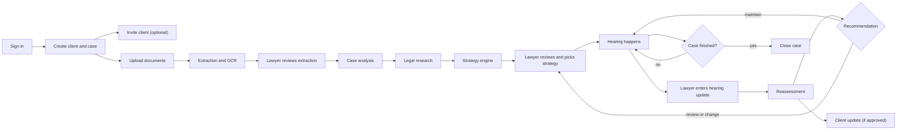
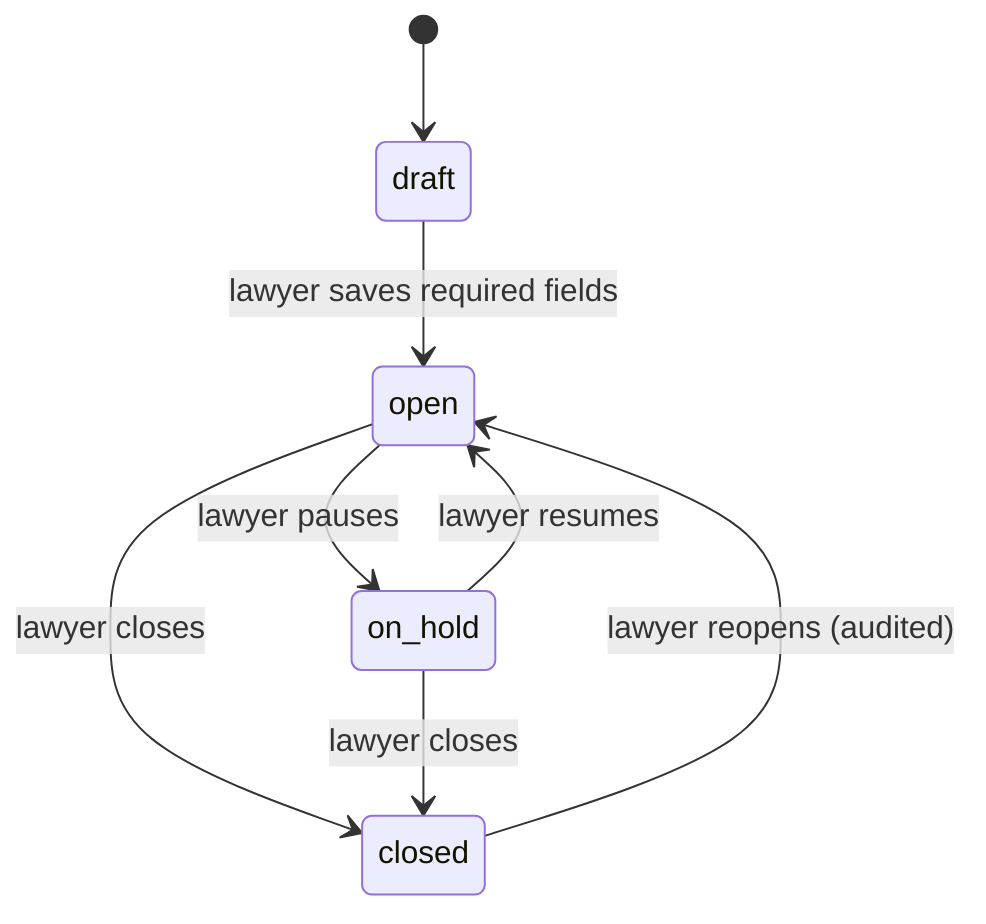
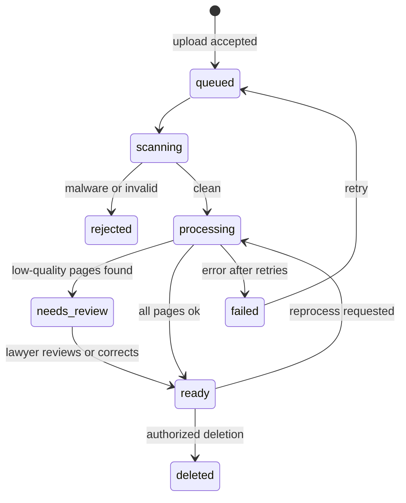
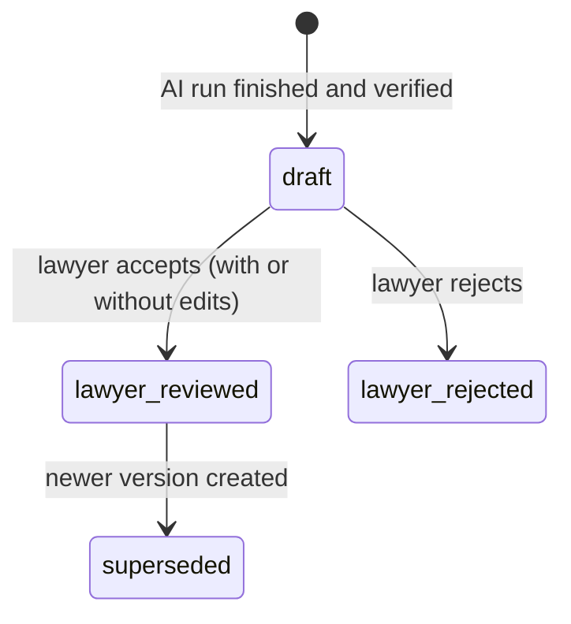
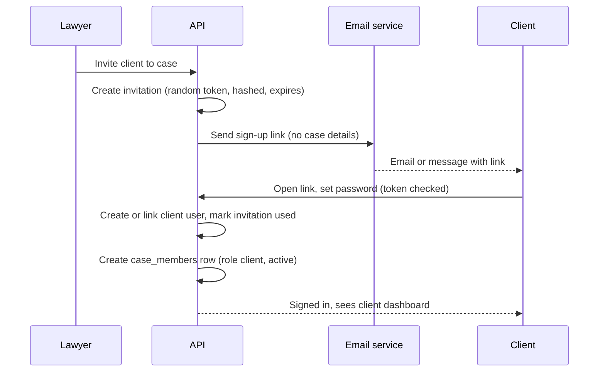
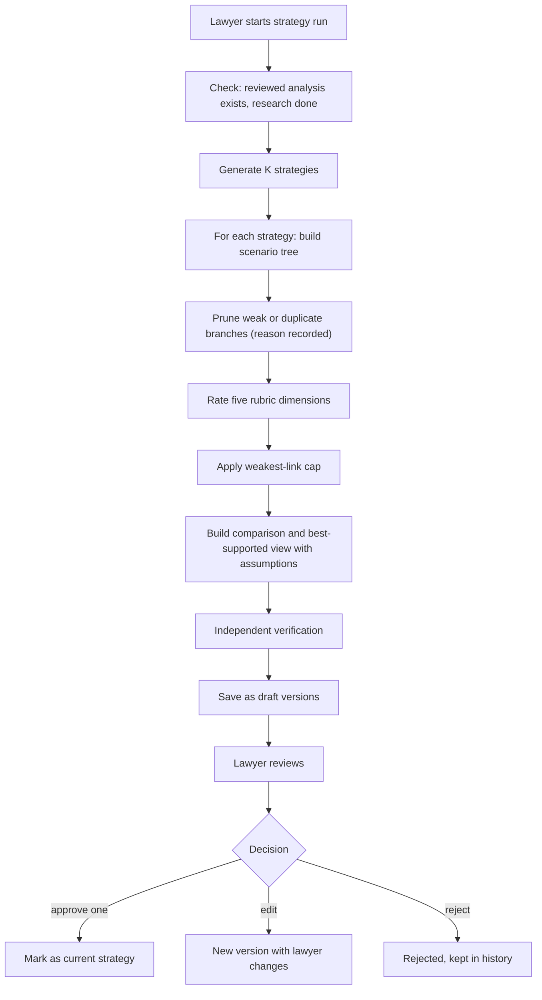

# Application Flow

How the system behaves from the moment a lawyer signs in to the moment a case is closed. `UserFlow.md` covers what users see. This file covers what the system does, which states exist, and which rules apply at each step.

## 1. Lifecycle at a glance

## 2. State machines

### 2.1 Case status

Rules:
- Closing revokes client membership for this case only (or sets it to read-only if the configured policy says so).
- Reopening does not restore client access automatically. The lawyer chooses to re-grant it.
- Closed cases are read-only for AI runs unless reopened.

### 2.2 Document processing status

### 2.3 AI output review status

Every analysis, strategy, and comparison follows this path:

Edits by the lawyer create a new version. Nothing is overwritten.

### 2.4 Strategy status

`draft` then `proposed` (shown in comparison), then `approved` (lawyer accepts it as viable), then `current` (the one being followed). Only one strategy per case can be `current`. A strategy moves to `superseded` when a new version replaces it, and to `rejected` if the lawyer rules it out.

### 2.5 Client update status

`draft` (AI or lawyer) then `published` (lawyer approval) and optionally `withdrawn`. Only `published` is visible to clients.

### 2.6 Hearing date status

`tentative` then `confirmed` (an authorized person confirms) then `held`, or `postponed` or `cancelled`. The AI can propose a next date from the lawyer's text, but only a person can set `confirmed`.

## 3. Flow 1: Sign-in and role routing

1. The user submits email and password.
2. The API checks rate limits and lockout, verifies the Argon2id hash, then verifies TOTP if enabled.
3. A session is created. The cookie is httpOnly and secure.
4. The web app calls `GET /me`. The role decides the route group:
   - `lawyer` goes to `/lawyer/overview`.
   - `client` goes to `/client/my-case` (or a case picker if more than one active case).
5. Every later request re-checks the session, the role, and, for case data, the case membership. The web app never trusts a role stored in the browser.

## 4. Flow 2: Create client and case

1. The lawyer creates a client profile (name, contact details, private notes).
2. The lawyer creates a case: title or reference, type, court, opposing party, description, key dates, client objectives, assigned team.
3. The system creates the case, a `case_members` row for the lead lawyer, and a stage list from the case-type template (editable).
4. An audit event is written (`case.create`).

## 5. Flow 3: Client invitation and access

Rules:
- The client reference shown to the lawyer is a label. It never works as a login or password.
- If the client already has an account (from an earlier case), the invitation links that account to the new case. The client signs in with their existing password.
- Tokens are single-use and expire. A new invitation revokes older ones for the same client and case.
- If email is not available, the lawyer can hand over the link in person; the same rules apply to the link.

## 6. Flow 4: Document upload and processing

1. The lawyer drops one or more files into the case workspace.
2. For each file the API checks: authenticated, active lawyer member with upload permission, size limit, content-type by magic bytes, allowed type.
3. The file is scanned. Infected or invalid files are rejected and logged.
4. The original is stored in private object storage. A `documents` row is created with a SHA-256 hash. If the same hash already exists in the case, the user is told it is a duplicate.
5. A processing job is queued. The API returns `202` with a job ID. The UI shows per-document progress through server-sent events.
6. The worker, per document:
   1. Detects the type. DOC is converted to DOCX or PDF in a sandbox.
   2. For each page: use the text layer if it has enough text; otherwise render the page image, pre-process it, and run OCR (Bengali and English).
   3. Save the page text, the method, OCR confidence, and a quality flag.
   4. Mark pages with low confidence, very little text, or suspected handwriting as `needs_review`.
   5. Clean the text, chunk it (chunks do not cross pages), embed the chunks, and save them with case, document, page, and version metadata.
   6. Set the document status to `ready` or `needs_review`.
7. The lawyer opens the document viewer: original on one side, extracted text on the other, with flagged pages highlighted.
8. If the lawyer corrects a page, the system saves a new page version, re-chunks and re-embeds that page, and marks affected analyses as possibly outdated.
9. Audit events: `document.upload`, `document.view`, `document.download`, `document.correct`.

Failure handling: each stage retries with backoff. After the retry limit the document goes to `failed` with a readable reason, and the lawyer can retry or replace the file.

## 7. Flow 5: Case analysis

1. The lawyer clicks "Analyze case" (or it starts after processing, if enabled). The API checks permission and creates a run.
2. Preconditions: at least one document is `ready` or `needs_review`. If pages are flagged, the UI warns that results depend on unreviewed text.
3. The orchestrator runs the stages (`Skills and agents.md` section 3): intake, facts and timeline, evidence, gaps and contradictions, legal research, verifier.
4. Each stage retrieves only from this case and the legal knowledge base. Each claim carries sources.
5. The verifier checks the claims. Unsupported claims are removed or flagged `unverified`.
6. The system saves analysis version N (status `draft`) with claims, timeline events, evidence items, contradictions, missing information, and research results.
7. The UI shows each finding with its source link and its label (document says, lawyer entered, AI inference, assumption, unverified).
8. The lawyer reviews and marks the analysis reviewed, edits items, or rejects them.

Triggers for a new analysis version: new documents added, a hearing update, a corrected page, or a manual request.

## 8. Flow 6: Legal research

1. Issues come from the case analysis. The lawyer can also add a research question.
2. The research agent runs hybrid search over approved legal source versions.
3. Each result shows: provision or judgment, why it may apply, the principle it supports, the current status and when it was last checked, and whether more research is needed.
4. The citation checker confirms each cited source exists in the knowledge base and that quoted text matches the stored text.
5. If nothing relevant exists in the knowledge base, the output says so plainly. The agent does not use memory as a fallback.
6. The lawyer can open the source text, mark a result useful or not, and add their own sources (flagged `lawyer_entered` until verified).

## 9. Flow 7: Strategy engine run

Details:
- **Scenario branch format:** our approach, possible opposing argument, our possible response, remaining risk. Wording marks every branch as a scenario.
- **Ratings:** `strong`, `moderate`, `weak`, `insufficient_information` on legal support, evidence support, resilience to opposing arguments, procedural fit, and information completeness.
- **Weakest-link cap:** the overall rating cannot exceed the weakest critical dimension. The comparison names the branch or gap that caused the cap.
- **No win probability** is computed or shown.
- **Settings:** K, depth, and breadth are shown on the run and saved with it.
- **Limits:** if a time, cost, or token limit is reached, the run ends as `partial` and lists what was not explored.
- **Lawyer control:** the lawyer can add their own strategy, edit any text, and request a re-run with changed objectives.

## 10. Flow 8: Hearing update and reassessment

1. Before a hearing, the lawyer creates or confirms the hearing (date, purpose). The date status starts `tentative` and becomes `confirmed` only when a person confirms it.
2. After the hearing the lawyer opens "Record hearing update" and fills the form: what happened, own arguments, opposing arguments, judge's remarks as recorded, new evidence, objections or procedural developments, orders or directions, next hearing date and whether it is confirmed, follow-up tasks.
3. On submit:
   1. The original note is stored unchanged with author and time, labelled `lawyer_entered`.
   2. A timeline event is added.
   3. New documents (orders, filings) can be uploaded in the same step and go through the normal pipeline.
   4. A task list is created from follow-ups.
   5. A reassessment job starts.
4. The reassessment agent loads the previous analysis and strategy versions, updates the facts and timeline, and creates a diff.
5. It finds which strategies and branches are affected, re-runs those parts, and checks for new opposing responses, risks, and evidence needs.
6. The verifier checks the new claims.
7. The system saves new versions linked to the old ones and shows:
   - What changed since the last analysis.
   - The recommendation: `maintain`, `review`, or `change_suggested`, with reasons and assumptions.
   - Any suggested strategy change and why it may matter.
8. The lawyer is notified. The lawyer decides whether to keep, edit, or change the current strategy.
9. Optionally, the lawyer asks for a client update draft (see Flow 9).

Edits to a hearing update create a new version. The original stays.

## 11. Flow 9: Client-visible updates

1. The lawyer opens "Client view" for the case. It lists every category the client can see, with an on or off switch for each:
   - Status label and stage label.
   - Plain-language explanation of the current stage.
   - Next confirmed hearing and whether the client must attend.
   - Client tasks.
   - Shared documents.
   - Published updates.
2. For an update, the lawyer writes text or asks the drafter agent for a draft. The drafter receives only fields the lawyer has marked shareable. It writes in Bangla or English, as the lawyer selects, with no internal analysis, strategy, or risk language.
3. The lawyer edits and clicks Publish. The text is copied into `client_visible_updates` with `approved_by` and `published_at`. The client receives an in-app notification with generic wording.
4. Later changes to internal notes or analyses never change a published update. The lawyer can withdraw an update; the client no longer sees it, and the audit log keeps it.
5. To share a document, the lawyer picks it and gives it a display name. The document appears in the client's shared list. Revoking removes it from the list and invalidates new download links.

## 12. Flow 10: Client dashboard

1. The client signs in and sees the cases where their membership is active.
2. The dashboard reads only the client-visible tables and the client task view.
3. It shows: current status and plain explanation, progress through stages (client labels), the next confirmed hearing and whether to attend, tasks the lawyer requested, shared documents, published updates, and notifications.
4. The client can mark a task done and upload a requested document into a task. Uploaded files go through the same validation and scanning as lawyer uploads, are stored against the case, and are visible to the lawyer only. The lawyer decides if they are used or shared back.
5. Nothing else is reachable. Requests for any other case ID, document, or lawyer endpoint return `404` (not `403`, to avoid confirming that a record exists).

## 13. Flow 11: Case closure

1. The lawyer clicks "Close case" and sees a summary of what will happen:
   - The case becomes read-only for AI runs.
   - The client loses access to this case (or gets read-only access, if the policy is set to that).
   - The client's other cases and the client account stay as they are.
   - Documents and data stay stored under the retention policy.
2. The lawyer confirms. The system, in one transaction:
   1. Sets `status = closed`, `closed_at`, `closed_by`, and `retention_until`.
   2. Sets client `case_members` to `revoked` (or `read_only`).
   3. Withdraws open client tasks and cancels pending notifications.
   4. Writes audit events.
3. Row level security makes the client access change immediate. Existing client sessions can no longer read the case.
4. The lawyer can still open the full history: documents, analyses, strategies, hearing records, and audit trail.
5. Reopening is possible and audited. Permanent deletion is a separate flow (Flow 12).

## 14. Flow 12: Retention and deletion

1. A lawyer with the right permission requests deletion of a document or a closed case.
2. The system shows what will be removed and checks `retention_until`. If the retention period has not ended, deletion is blocked unless an override with a reason is allowed by policy.
3. After a second confirmation the deletion job removes chunks and embeddings, then claims and sources that depend only on the removed data, then derived text, then original objects, then rows.
4. An audit event records the counts and the reason, without content.
5. Analyses that cited deleted documents are marked `source_removed` so the lawyer sees that some citations no longer resolve.

## 15. Flow 13: Legal knowledge base updates (admin)

1. An administrator imports a source (act, rule, judgment) from an approved origin. The record stores the source name, URL, date, issuing authority, language, and licence note.
2. The system stores a new version with a content hash and marks it `pending`.
3. A reviewer compares it with the official text and approves or rejects. Approval creates chunks and embeddings.
4. If the text changed, the previous version stays in history with `effective_to` set. `is_current` moves to the new version.
5. Amendments and repeals update `current_status` and `status_verified_on`.
6. Open analyses that cited a changed provision are flagged for re-verification, and the lawyer sees a notice.

## 16. Cross-cutting rules

| Rule | Where it applies |
|---|---|
| Every request is authenticated, then authorized by role, then by case membership, then by database row level security | All |
| Retrieval filters by case in SQL | Analysis, strategy, reassessment |
| Document text is data, never instructions | All agent prompts |
| AI outputs start as `draft` and carry sources | All agent outputs |
| History is kept through versions | Pages, analyses, strategies, comparisons, hearing updates, client updates |
| Sensitive actions write audit events | Login, access changes, view and download, AI runs, publish, close, delete |
| Long jobs are idempotent and report progress | Processing, analysis, strategy, reassessment |
| AI never sets a confirmed hearing date or a client instruction | Hearings, tasks, updates |

## 17. Error and edge cases

| Situation | Behavior |
|---|---|
| Upload with wrong type or spoofed extension | Reject with a clear message, log the attempt |
| Encrypted or corrupt PDF | Mark `failed` with reason; ask for a new file |
| Very poor scan | `needs_review`; analysis warns that results rely on unreviewed text |
| Mixed Bangla and English page | OCR with both languages; per-line language kept where possible |
| LLM provider unavailable | Analysis job waits or fails with a retry option; upload and viewing still work |
| Verifier marks many claims unsupported | The draft is shown with a warning banner; unsupported claims are hidden by default and viewable in a "removed claims" panel |
| Two strategy runs started at once | Second request is refused with the running job ID |
| Lawyer edits a page after analysis | Analysis shows "based on earlier text" until re-run |
| Client opens an old link after closure | Sign-in works; the case is not listed; direct URL returns 404 |
| Revoked team member holds an open session | Next request fails the membership check |
| Hearing date entered in the past | Warning; the lawyer confirms or corrects |
| Case has no documents yet | Analysis disabled; strategy disabled; the UI explains why |
