# Backend Developer Orchestration & Work Division

This document specifies the exact division of responsibilities, ownership boundaries, and coordination protocols between the two backend developers (**Backend Dev 1** and **Backend Dev 2**) working on the PokkhoAI backend.

The architecture, conventions, and endpoint structures strictly follow **[TRD.md](./TRD.md)**, **[PRD.md](./PRD.md)** (Section 9 Delivery Phases), and **[database.md](./database.md)**.

---

## 1. Core Ownership Principles

To guarantee clean separation, zero migration conflicts, and absolute multi-tenant data isolation:
- **Backend Dev 1: Core Platform, Security, API Gateway, and Workspace**
  - Owns: Database baseline, Alembic migrations, PostgreSQL RLS policies, Auth/Sessions/CSRF, Case & Client domains, Lawyer & Client Portal APIs, Audit Logging, and Notifications/SSE infrastructure.
- **Backend Dev 2: Pipeline, Ingestion, Workers, RAG, and AI Strategy Engine**
  - Owns: Object Storage (S3/MinIO), Document validation/sanitization & malware scanning, Sandboxed OCR (Tesseract) & extraction pipelines, Background worker (Redis + Celery/ARQ), Legal corpus ingestion, Hybrid RAG with pgvector, and LLM Gateway (structured output, analysis, chess strategy engine).
- **Mutual Review Gate**: Any change to shared database schemas (`DOCS/database.md`), job contract payloads, or inter-service contracts requires sign-off from both developers.

---

## 2. Complete Phase-by-Phase Roadmap (Phases 1 to 8)

The backend build order follows the 8 delivery phases defined in **PRD.md Section 9** and **AGENTS.md**:

```mermaid
flowchart TD
    subgraph P1["Phase 1: Foundation"]
        D1_P1["Dev 1: Docker Compose, DB Setup, Alembic Baseline, Auth, RLS, Case Domain"]
        D2_P1["Dev 2: Celery/ARQ Worker Runner, Redis Broker, S3/MinIO Setup"]
    end

    subgraph P2["Phase 2: Two Dashboards & Client Portal"]
        D1_P2["Dev 1: Lawyer & Client Portal APIs (/client), Invitations, Client Visibility Layer"]
        D2_P2["Dev 2: Background Job SSE Streaming (/jobs/{id}/events), Event Bus"]
    end

    subgraph P3["Phase 3: Documents & Processing"]
        D2_P3["Dev 2: Secure Upload, ClamAV, Sandboxed OCR, PyMuPDF, Page Review API"]
        D1_P3["Dev 1: Document RLS Verification, File Access Authorization & Audit Trail"]
    end

    subgraph P4["Phase 4: RAG & Legal Knowledge Base"]
        D2_P4["Dev 2: Ingest data-scrapper/ into legal_chunks, Chunking Engine, pgvector Hybrid Search"]
        D1_P4["Dev 1: Case-Scoped SQL Filters, Legal Sources Admin APIs & Tenant Isolation"]
    end

    subgraph P5["Phase 5: Case Analysis"]
        D2_P5["Dev 2: Analysis AI Worker, Timeline/Chronology, Evidence & Contradiction Detection"]
        D1_P5["Dev 1: Claims Immutability, Source Citation Verification & Facts APIs"]
    end

    subgraph P6["Phase 6: Strategy Engine"]
        D2_P6["Dev 2: Chess Scenario Tree, Opponent Moves, Counter-Arguments & Rubric Comparison"]
        D1_P6["Dev 1: Strategy Versioning, Supersedes Chains, Lawyer Edit & Approval APIs"]
    end

    subgraph P7["Phase 7: Hearings & Reassessment"]
        D1_P7["Dev 1: Hearing Logs, Calendar, Draft Client Updates & Publishing Lifecycle"]
        D2_P7["Dev 2: Hearing Reassessment AI Task, Diffing & Targeted Branch Re-runs"]
    end

    subgraph P8["Phase 8: Hardening & Production Readiness"]
        D1_P8["Dev 1: Security Suite, Penetration Testing, Hash-Chained Audit Logs, RLS Audit"]
        D2_P8["Dev 2: Worker Queue Concurrency, Rate Limiting, AI Provider Latency & Caching"]
    end

    P1 --> P2
    P2 --> P3
    P3 --> P4
    P4 --> P5
    P5 --> P6
    P6 --> P7
    P7 --> P8
```

---

### Detailed Phase Breakdown

#### Phase 1: Foundation
*Exit Check: Multi-tenant and case isolation tests pass.*
| Module | Scope | Owner |
|---|---|---|
| **Project Setup & Infra** | Docker Compose (`db`, `redis`, `minio`), uv `pyproject.toml`, FastAPI app factory | **Backend Dev 1** |
| **Database & Base Models** | PostgreSQL 16+ setup, `pgvector`/`pg_trgm`/`citext` extensions, Alembic baseline, initial tables | **Backend Dev 1** |
| **Row Level Security (RLS)** | Session context helper `SET LOCAL app.current_user_id`, baseline RLS policies | **Backend Dev 1** |
| **Auth & Security** | Argon2id hashing, session cookies, CSRF protection, `/auth/*` endpoints, RBAC dependencies | **Backend Dev 1** |
| **Case & Client Domain** | `clients`, `cases`, `case_members` tables, case creation & membership authorization | **Backend Dev 1** |
| **Worker Scaffold** | Redis broker setup, Celery/ARQ worker integration, base job models (`jobs` table) | **Backend Dev 2** |
| **Storage Scaffold** | S3/MinIO client wrapper, bucket initialization, presigned URL generator | **Backend Dev 2** |

#### Phase 2: Two Dashboards & Client Portal
*Exit Check: Client portal is isolated by construction and sees only lawyer-approved data.*
| Module | Scope | Owner |
|---|---|---|
| **Lawyer Dashboard API** | Overview stats, active cases, team management, case member invites | **Backend Dev 1** |
| **Client Portal Namespace** | Isolated `/api/v1/client/*` endpoints (cases, updates, tasks, documents) | **Backend Dev 1** |
| **Client Activation & Invitations** | Hashed single-use invitation tokens, activation flow, password setup | **Backend Dev 1** |
| **Client Visibility Layer** | `client_visible_updates`, `client_shared_documents`, `client_tasks` tables & APIs | **Backend Dev 1** |
| **Case Closure & Revocation** | Case close/reopen logic, immediate revocation of client access via RLS | **Backend Dev 1** |
| **Job Progress & Events** | SSE event stream `/jobs/{id}/events` and polling `/jobs/{id}` | **Backend Dev 2** |
| **Audit Logging Baseline** | Append-only audit logger middleware capturing actor, action, IP, case ID | **Backend Dev 1** |

#### Phase 3: Documents & Ingestion
*Exit Check: Real Bengali and English PDFs/scans process correctly; original files remain source of truth.*
| Module | Scope | Owner |
|---|---|---|
| **Secure Upload Handler** | `POST /cases/{case_id}/documents`, MIME validation (magic bytes), size limits, ClamAV scan | **Backend Dev 2** |
| **Original File Vault** | MinIO private bucket storage, encryption, presigned download URLs with audit hooks | **Backend Dev 2** |
| **Extraction Pipeline** | Sandboxed worker: PyMuPDF digital text layer, python-docx parser | **Backend Dev 2** |
| **OCR Worker** | Tesseract OCR (Bengali `ben` + English `eng`), deskew, denoise, confidence scoring | **Backend Dev 2** |
| **Page Review & Versioning** | Extracted page models, `needs_review` quality flags, lawyer correction endpoint (`PATCH /pages/{num}`) | **Backend Dev 2** |
| **Document Authorization** | Case-level authorization checks on all document endpoints, delete-with-reason | **Backend Dev 1** |

#### Phase 4: RAG & Legal Knowledge Base
*Exit Check: Retrieval queries strictly scoped by case; zero cross-tenant chunk leakage.*
| Module | Scope | Owner |
|---|---|---|
| **Scraper Dataset Ingestion** | Ingestion pipeline loading `data-scrapper/data/processed/` into `legal_sources` & `legal_chunks` | **Backend Dev 2** |
| **Chunking Engine** | Page-bounded sentence/paragraph chunking (~300-600 tokens), char offsets, provenance metadata | **Backend Dev 2** |
| **Vector Embeddings** | Multilingual embedding pipeline (`multilingual-e5-base` / `BGE-M3`), pgvector HNSW indexing | **Backend Dev 2** |
| **Hybrid Retrieval Service** | Vector similarity + full-text search (`pg_trgm`), Reciprocal Rank Fusion (RRF), cross-encoder rerank | **Backend Dev 2** |
| **Case Scope Enforcement** | SQL-level `WHERE case_id = :case_id` enforcement, RLS validation tests | **Backend Dev 1** |
| **Legal KB Admin APIs** | `/legal-sources`, `/admin/legal-sources/ingest`, `/legal-sources/verify-citation` | **Backend Dev 2** (reviewed with Dev 1) |

#### Phase 5: Case Analysis
*Exit Check: Every finding links to a verifiable document chunk or legal source; no invented claims.*
| Module | Scope | Owner |
|---|---|---|
| **LLM Gateway** | Provider-agnostic gateway, mock provider for tests, structured Pydantic output validation | **Backend Dev 2** |
| **Fact & Chronology Engine** | Entity extraction (people, dates, places, events), timeline construction (`/timeline`) | **Backend Dev 2** |
| **Evidence & Contradiction Engine**| Evidence mapping (supporting vs weakening), document contradiction detector, missing info gaps | **Backend Dev 2** |
| **Claims & Verification Schema** | `claims`, `claim_sources`, `verification_results` tables; rejection of unsourced claims | **Backend Dev 1** |
| **Analysis API Endpoints** | `POST /cases/{id}/analysis-runs`, `GET /analyses/{id}`, `GET /facts`, `GET /evidence`, `GET /gaps` | **Backend Dev 2** (reviewed with Dev 1) |

#### Phase 6: Strategy Engine
*Exit Check: Chess scenario tree generated with depth/breadth limits, rubric comparison, and versioning.*
| Module | Scope | Owner |
|---|---|---|
| **Strategy Generation Worker** | Propose $K$ candidate strategies, legal basis, supporting claims, risk assessment | **Backend Dev 2** |
| **Chess Scenario Tree** | Tree expansion: opponent argument nodes, counter-arguments, remaining risk (depth $D$, breadth $B$) | **Backend Dev 2** |
| **Rubric & Comparison Evaluator** | 5-dimension rubric scoring, weakest-dimension ceiling aggregation rule, comparison matrix | **Backend Dev 2** |
| **Strategy Versioning & History** | Immutability models (`version`, `supersedes_id`), diff tracking, edit endpoint (`PATCH /strategies/{id}`) | **Backend Dev 1** |
| **Lawyer Approval Workflow** | `POST /strategies/{id}/approve`, `POST /reject`, latest comparison view | **Backend Dev 1** |

#### Phase 7: Hearings & Reassessment
*Exit Check: Hearing updates preserve history, trigger targeted strategy reassessments, and draft client updates.*
| Module | Scope | Owner |
|---|---|---|
| **Hearings & Calendar API** | `GET, POST /cases/{id}/hearings`, `GET, PATCH /hearings/{id}`, `/calendar` endpoint | **Backend Dev 1** |
| **Hearing Reassessment Worker** | Diff new hearing outcome against active strategy tree; targeted branch re-evaluation | **Backend Dev 2** |
| **Client Update Drafting** | Generate draft client summary from hearing outcome; lawyer approval gate before publishing | **Backend Dev 1** |
| **Reassessment History** | Version chain linking previous strategy analysis to reassessed strategy analysis | **Backend Dev 1** |

#### Phase 8: Hardening & Production Readiness
*Exit Check: Passes complete security checklist in `Security.md` and performance targets in TRD Section 13.*
| Module | Scope | Owner |
|---|---|---|
| **Isolation Test Suite** | Multi-tenant isolation test suite (two lawyers, two clients, overlapping queries) | **Backend Dev 1** |
| **Security & Penetration Testing**| Rate limiting, lockout backoff, CSRF validation, file sandbox validation | **Backend Dev 1** |
| **Audit Log Tamper-Evident Chain**| Hash-chain verification on append-only audit log table | **Backend Dev 1** |
| **Worker Concurrency & Caching** | Worker throughput, Redis caching, job queue depth monitoring, timeout handling | **Backend Dev 2** |
| **AI Gateway Performance & Safety**| Token/cost budget caps per user/day, data egress verification against approved provider list | **Backend Dev 2** |

---

## 3. TRD Endpoint Catalog Ownership (Quick Reference)

### Backend Dev 1 Endpoints
- **Auth**: `POST /auth/register`, `POST /auth/login`, `POST /auth/logout`, `POST /auth/logout-all`, `POST /auth/password/forgot`, `POST /auth/password/reset`, `POST /auth/mfa/setup`, `POST /auth/mfa/verify`, `POST /auth/invitations/accept`, `GET /me`.
- **Clients & Cases**: `GET, POST /clients`, `GET, PATCH /clients/{id}`, `GET, POST /cases`, `GET, PATCH /cases/{id}`, `POST /cases/{id}/close`, `POST /cases/{id}/reopen`, `GET, POST /cases/{id}/members`, `DELETE /cases/{id}/members/{id}`, `POST /cases/{id}/invitations`, `DELETE /cases/{id}/invitations/{id}`, `GET /cases/{id}/timeline`, `GET /cases/{id}/audit`.
- **Hearings & Calendar**: `GET, POST /cases/{id}/hearings`, `GET, PATCH /hearings/{id}`, `POST /hearings/{id}/updates`, `GET /hearings/{id}/reassessment`, `GET /calendar`.
- **Client-Visible (Lawyer Admin)**: `GET, POST /cases/{id}/client-updates`, `PATCH /client-updates/{id}`, `POST /client-updates/{id}/publish`, `POST /client-updates/{id}/withdraw`, `POST, DELETE /cases/{id}/shared-documents`, `GET, POST, PATCH /cases/{id}/tasks`, `PATCH /cases/{id}/client-visibility`.
- **Client Portal**: `GET /client/cases`, `GET /client/cases/{id}`, `GET /client/cases/{id}/updates`, `GET /client/cases/{id}/hearing`, `GET /client/cases/{id}/tasks`, `PATCH /client/tasks/{id}`, `GET /client/cases/{id}/documents`, `GET /client/documents/{id}/download-url`, `GET /client/notifications`.
- **Jobs & Events**: `GET /jobs/{id}`, SSE `GET /jobs/{id}/events`.

### Backend Dev 2 Endpoints & Worker Jobs
- **Documents**: `POST /cases/{id}/documents`, `GET /cases/{id}/documents`, `GET /documents/{id}`, `GET /documents/{id}/download-url`, `GET /documents/{id}/pages`, `PATCH /documents/{id}/pages/{page_no}`, `POST /documents/{id}/reprocess`, `DELETE /documents/{id}`.
- **Analysis**: `POST /cases/{id}/analysis-runs`, `GET /cases/{id}/analyses`, `GET /analyses/{id}`, `GET /cases/{id}/facts`, `GET /cases/{id}/evidence`, `GET /cases/{id}/contradictions`, `GET /cases/{id}/gaps`.
- **Legal KB & Research**: `POST /cases/{id}/research-runs`, `GET /cases/{id}/research-results`, `GET /legal-sources`, `GET /legal-sources/{id}`, `GET /legal-sources/{id}/versions`, `POST /legal-sources/verify-citation`, `POST /admin/legal-sources/ingest`, `POST /admin/legal-sources/{id}/approve`.
- **Strategy Engine**: `POST /cases/{id}/strategy-runs`, `GET /cases/{id}/strategies`, `GET /strategies/{id}`, `GET /strategies/{id}/scenarios`, `PATCH /strategies/{id}`, `POST /strategies/{id}/approve`, `POST /strategies/{id}/reject`, `GET /cases/{id}/strategy-comparisons/latest`, `GET /strategies/{id}/history`.

---

## 4. Mandatory Standards & Protocols

1. **Schema First**: Any table change in `DOCS/database.md` or Alembic migration must be reviewed by both developers.
2. **OpenAPI 3.1 Documentation Requirement**: Every single endpoint must include:
   - Operation `summary` and detailed endpoint docstrings / `description`.
   - Explicit typed `response_model` (Pydantic, no raw dicts).
   - Parameter descriptions via `Annotated[..., Query/Path/Body(description=...)]`.
   - Declared error responses conforming to `application/problem+json` (RFC 7807).
   - Clean OpenAPI tags for Swagger UI (`/docs`) and Redoc (`/redoc`).
3. **Multi-Tenant Data Isolation Guarantee**:
   - Every case query enforces SQL `WHERE case_id = :case_id` AND PostgreSQL RLS (`SET LOCAL app.current_user_id`).
   - No module is marked "Done" until tenant isolation tests pass.
4. **Immutability & Versioning**:
   - AI outputs, page extractions, claims, and strategies are never updated in place. They write new records with `version` and `supersedes_id`.
5. **Status Tracking**: Keep `DOCS/status.md` updated as modules transition across phases.

---

## 5. Two FastAPI apps: current boundary (2026-11-20)

The backend currently has two separate applications:

| App | Entry point | Owner | Auth / RLS |
|---|---|---|---|
| Platform API | `backend/app/main.py` (`app.main:app`, `[tool.fastapi]` entrypoint) | Arafath (was Backend Dev 1) | Lawyer/client sessions, `CaseAccess`, transaction-local `app.current_user_id`, RLS |
| Pipeline / AI API | `backend/src/main.py` (run from repo root as `backend.src.main:app`) | Arafath (Backend Dev 2) | None. No authentication, CORS `*`, in-memory storage for analysis, strategy, and hearings |

Ownership (2026-11-20): Arafath (Backend Dev 2) currently owns both `backend/app/` and `backend/src/`. Both-developer review for shared schema changes is satisfied by Arafath's sign-off while this holds.

Decisions (Arafath, 2026-11-20):

- Merging `backend/src/main.py` into `app/` is **approved**. It is a separate, later step and is not done yet.
- Until the merge, new work from `DOCS/PokkhoAI_master_prompt.md` (RAG ingestion, retrieval, facts, analysis, strategy tree, hearing reassessment, eval) is built in `backend/app/` only, behind `app/` authentication, `CaseAccess`, and RLS, with Alembic migrations.
- `backend/src/` is not extended before the merge. Rule fixes in it are allowed (done 2026-11-20: template precedents and strategies removed, mock-only provider default, hard-coded credentials removed).
- `backend/src/main.py` must not be exposed beyond localhost: it has no access control (Legal Product Rule 7).
- Migrations `0009`/`0010` were never applied anywhere; their policies were changed in place to `app.is_lawyer_member(case_id)` and the client read policy on `strategies` was removed (Rule 8).
