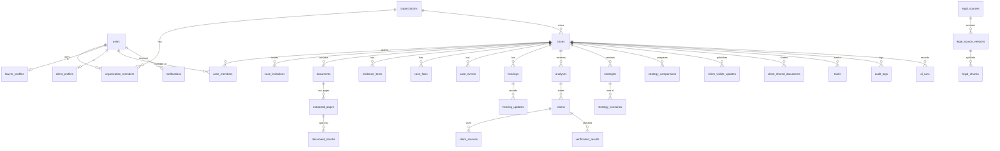

# Database Design

Database: PostgreSQL 16+ with the `pgvector`, `pg_trgm`, and `citext` extensions.
Status: Draft 1. This schema follows the entity list in `Idea.md` section 20 and changes it where analysis called for it (see section 12). Review it before the first migration, and write the real migrations with Alembic.

## 1. Design rules

1. **Original files are the source of truth.** Extracted text, chunks, and embeddings are derived and can be rebuilt.
2. **Everything case-scoped carries `case_id` and `organization_id`.** This makes row level security and retrieval filters simple and cheap.
3. **Row level security (RLS) is on for every case table**, and the application connects with a role that cannot bypass it.
4. **Versioned, never overwritten:** extracted page text, analyses, strategies, strategy comparisons, and client updates keep history through `version` and `supersedes_id`.
5. **Client-visible data lives in separate tables.** The client portal reads only those tables.
6. **Claims are first-class.** Every AI statement is a row in `claims` with typed sources, so verification and citation are queryable.
7. **UTC timestamps** (`timestamptz`). UUID primary keys.
8. **Soft deletion by status** where retention rules apply. Permanent deletion goes through a separate audited procedure.
9. **Text enums use `CHECK` constraints** rather than native enum types, so values can change in migrations without painful type alterations.

## 2. Entity overview



## 3. Setup

```sql
CREATE EXTENSION IF NOT EXISTS vector;
CREATE EXTENSION IF NOT EXISTS pg_trgm;
CREATE EXTENSION IF NOT EXISTS citext;
CREATE SCHEMA IF NOT EXISTS app;

-- Current user from the request transaction (set by the API with SET LOCAL)
CREATE OR REPLACE FUNCTION app.current_user_id() RETURNS uuid
LANGUAGE sql STABLE AS $$
  SELECT nullif(current_setting('app.current_user_id', true), '')::uuid
$$;
```

Database roles:
- `app_owner`: owns tables and runs migrations. Never used by the running application.
- `app_user`: used by the API and workers. No `BYPASSRLS`, no `SUPERUSER`, no table ownership.
- `app_admin_ingest`: used only by the legal source ingestion job. Can write the shared legal tables, cannot read case tables.

## 4. Identity and tenancy

```sql
CREATE TABLE organizations (
  id            uuid PRIMARY KEY DEFAULT gen_random_uuid(),
  name          text NOT NULL,
  kind          text NOT NULL DEFAULT 'individual' CHECK (kind IN ('individual','chamber','firm')),
  created_at    timestamptz NOT NULL DEFAULT now()
);

CREATE TABLE users (
  id             uuid PRIMARY KEY DEFAULT gen_random_uuid(),
  email          citext NOT NULL UNIQUE,
  password_hash  text,                                  -- Argon2id; null until invitation accepted
  role           text NOT NULL CHECK (role IN ('lawyer','client','admin')),
  status         text NOT NULL DEFAULT 'active' CHECK (status IN ('invited','active','suspended','deactivated')),
  full_name      text NOT NULL,
  phone          text,
  preferred_language text NOT NULL DEFAULT 'en' CHECK (preferred_language IN ('en','bn')),
  mfa_secret_enc bytea,                                 -- encrypted TOTP secret
  mfa_enabled    boolean NOT NULL DEFAULT false,
  failed_logins  int NOT NULL DEFAULT 0,
  locked_until   timestamptz,
  last_login_at  timestamptz,
  created_at     timestamptz NOT NULL DEFAULT now(),
  updated_at     timestamptz NOT NULL DEFAULT now()
);

CREATE TABLE organization_members (
  organization_id uuid NOT NULL REFERENCES organizations(id),
  user_id         uuid NOT NULL REFERENCES users(id),
  org_role        text NOT NULL CHECK (org_role IN ('owner','lawyer','assistant')),
  status          text NOT NULL DEFAULT 'active' CHECK (status IN ('active','removed')),
  PRIMARY KEY (organization_id, user_id)
);

CREATE TABLE lawyer_profiles (
  user_id        uuid PRIMARY KEY REFERENCES users(id),
  bar_enrollment_no text,                               -- as entered; verification is a later feature
  practice_areas text[],
  courts         text[],
  chamber_name   text
);

CREATE TABLE client_profiles (
  id              uuid PRIMARY KEY DEFAULT gen_random_uuid(),
  organization_id uuid NOT NULL REFERENCES organizations(id),
  user_id         uuid UNIQUE REFERENCES users(id),     -- null until the client activates the account
  display_name    text NOT NULL,
  email           citext,
  phone           text,
  address         text,
  national_id_enc bytea,                                -- optional, field-encrypted; not stored by default
  internal_notes  text,                                 -- lawyer-only, never client-visible
  created_by      uuid NOT NULL REFERENCES users(id),
  created_at      timestamptz NOT NULL DEFAULT now()
);
CREATE INDEX ON client_profiles (organization_id);

CREATE TABLE sessions (
  id            uuid PRIMARY KEY DEFAULT gen_random_uuid(),
  user_id       uuid NOT NULL REFERENCES users(id),
  token_hash    bytea NOT NULL UNIQUE,                  -- hash of the opaque session token
  created_at    timestamptz NOT NULL DEFAULT now(),
  expires_at    timestamptz NOT NULL,
  revoked_at    timestamptz,
  ip            inet,
  user_agent    text
);
CREATE INDEX ON sessions (user_id) WHERE revoked_at IS NULL;

CREATE TABLE password_reset_tokens (
  id          uuid PRIMARY KEY DEFAULT gen_random_uuid(),
  user_id     uuid NOT NULL REFERENCES users(id),
  token_hash  bytea NOT NULL UNIQUE,
  expires_at  timestamptz NOT NULL,
  used_at     timestamptz
);
```

Revision `0004_b9_auth_support` adds the `mfa_recovery_codes` table and the
constrained password-reset lookup/consume security-definer functions. Recovery
codes are stored as SHA-256 hashes, and TOTP secrets are encrypted application-side
before they are written to `users.mfa_secret_enc`.

Anonymous authentication lookup must not use a general RLS bypass. The Phase 1
auth-support migration adds narrowly scoped `SECURITY DEFINER` functions for
email/session lookup, login lockout updates, and per-IP throttling. They use a
fixed `search_path`, are owned by `app_owner`, and are executable by `app_user`
only. The internal rate-limit table is forced through RLS with no direct
`app_user` policy or table grant; its function maintains a 15-minute window.
Session revocation also uses a scoped security-definer function: the normal
session SELECT policy hides revoked sessions, so direct updates cannot safely
revoke an active session without weakening that visibility rule. The function
only revokes sessions belonging to the transaction's current user.

```sql
CREATE TABLE auth_login_ip_limits (
  ip               inet PRIMARY KEY,
  window_started_at timestamptz NOT NULL,
  attempt_count    integer NOT NULL CHECK (attempt_count > 0),
  updated_at       timestamptz NOT NULL DEFAULT now()
);
```

## 5. Cases, membership, invitations

```sql
CREATE TABLE cases (
  id               uuid PRIMARY KEY DEFAULT gen_random_uuid(),
  organization_id  uuid NOT NULL REFERENCES organizations(id),
  reference_no     text NOT NULL,                       -- internal reference
  title            text NOT NULL,
  case_type        text NOT NULL,                       -- configurable list
  workflow_template_id uuid,                            -- stage template, see case_stages
  court            text,
  court_case_no    text,
  jurisdiction     text,
  opposing_party   text,
  description      text,
  internal_notes   text,                                -- lawyer-only
  client_objectives text,                               -- entered by the lawyer; feeds strategy runs
  status           text NOT NULL DEFAULT 'open' CHECK (status IN ('draft','open','on_hold','closed')),
  current_stage    text,
  key_dates        jsonb NOT NULL DEFAULT '{}'::jsonb,
  closed_at        timestamptz,
  closed_by        uuid REFERENCES users(id),
  retention_until  date,
  created_by       uuid NOT NULL REFERENCES users(id),
  created_at       timestamptz NOT NULL DEFAULT now(),
  updated_at       timestamptz NOT NULL DEFAULT now(),
  UNIQUE (organization_id, reference_no)
);
CREATE INDEX ON cases (organization_id, status);

CREATE TABLE case_stages (                              -- per-case stage list; supports different workflows
  id          uuid PRIMARY KEY DEFAULT gen_random_uuid(),
  case_id     uuid NOT NULL REFERENCES cases(id),
  organization_id uuid NOT NULL,
  position    int NOT NULL,
  name        text NOT NULL,
  client_label text,                                    -- plain-language label shown to client when shared
  status      text NOT NULL DEFAULT 'pending' CHECK (status IN ('pending','current','done','skipped')),
  UNIQUE (case_id, position)
);

CREATE TABLE case_members (
  id                 uuid PRIMARY KEY DEFAULT gen_random_uuid(),
  case_id            uuid NOT NULL REFERENCES cases(id),
  organization_id    uuid NOT NULL,
  user_id            uuid NOT NULL REFERENCES users(id),
  client_profile_id  uuid REFERENCES client_profiles(id),
  role               text NOT NULL CHECK (role IN ('lead_lawyer','team_lawyer','assistant','client')),
  permissions        jsonb NOT NULL DEFAULT '{}'::jsonb, -- e.g. {"can_upload":true,"can_run_ai":true,...}
  status             text NOT NULL DEFAULT 'active' CHECK (status IN ('active','read_only','revoked')),
  granted_by         uuid NOT NULL REFERENCES users(id),
  granted_at         timestamptz NOT NULL DEFAULT now(),
  revoked_at         timestamptz,
  UNIQUE (case_id, user_id),
  CHECK ((role = 'client') = (client_profile_id IS NOT NULL))
);
CREATE INDEX ON case_members (user_id, status);

CREATE TABLE case_invitations (
  id                 uuid PRIMARY KEY DEFAULT gen_random_uuid(),
  case_id            uuid NOT NULL REFERENCES cases(id),
  organization_id    uuid NOT NULL,
  client_profile_id  uuid NOT NULL REFERENCES client_profiles(id),
  email              citext NOT NULL,
  client_reference   text NOT NULL,                     -- human-friendly reference; grants nothing by itself
  token_hash         bytea NOT NULL UNIQUE,             -- random token, stored hashed, single use
  expires_at         timestamptz NOT NULL,
  accepted_at        timestamptz,
  revoked_at         timestamptz,
  created_by         uuid NOT NULL REFERENCES users(id),
  created_at         timestamptz NOT NULL DEFAULT now()
);
```

### Membership helper functions (used by RLS)

```sql
CREATE OR REPLACE FUNCTION app.is_lawyer_member(p_case uuid) RETURNS boolean
LANGUAGE sql STABLE SECURITY DEFINER SET search_path = public AS $$
  SELECT EXISTS (
    SELECT 1 FROM case_members m
    WHERE m.case_id = p_case
      AND m.user_id = app.current_user_id()
      AND m.status = 'active'
      AND m.role IN ('lead_lawyer','team_lawyer','assistant'))
$$;

CREATE OR REPLACE FUNCTION app.is_client_member(p_case uuid) RETURNS boolean
LANGUAGE sql STABLE SECURITY DEFINER SET search_path = public AS $$
  SELECT EXISTS (
    SELECT 1 FROM case_members m
    WHERE m.case_id = p_case
      AND m.user_id = app.current_user_id()
      AND m.status = 'active'
      AND m.role = 'client')
$$;
```

A closed case sets client memberships to `revoked` (or `read_only` if the policy allows read access). `is_client_member` only accepts `active`, so access stops at once.

## 6. Documents, pages, chunks

> Implemented schema differs from the design below; see section 17 (migrations 0011-0014).

```sql
CREATE TABLE documents (
  id               uuid PRIMARY KEY DEFAULT gen_random_uuid(),
  case_id          uuid NOT NULL REFERENCES cases(id),
  organization_id  uuid NOT NULL,
  title            text NOT NULL,
  original_filename text NOT NULL,
  mime_type        text NOT NULL,
  size_bytes       bigint NOT NULL,
  sha256           bytea NOT NULL,
  storage_key      text NOT NULL,                       -- object storage key of the original
  doc_type         text,                                -- set by intake agent or lawyer
  language         text CHECK (language IN ('bn','en','mixed','unknown')),
  page_count       int,
  scan_status      text NOT NULL DEFAULT 'pending' CHECK (scan_status IN ('pending','clean','infected','failed')),
  processing_status text NOT NULL DEFAULT 'queued'
      CHECK (processing_status IN ('queued','processing','ready','needs_review','failed','deleted')),
  processing_error text,
  uploaded_by      uuid NOT NULL REFERENCES users(id),
  uploaded_at      timestamptz NOT NULL DEFAULT now(),
  deleted_at       timestamptz,
  UNIQUE (case_id, sha256)
);
CREATE INDEX ON documents (case_id, processing_status);

CREATE TABLE extracted_pages (                          -- one row per page per text version
  id             uuid PRIMARY KEY DEFAULT gen_random_uuid(),
  document_id    uuid NOT NULL REFERENCES documents(id),
  case_id        uuid NOT NULL,
  organization_id uuid NOT NULL,
  page_no        int NOT NULL,
  version        int NOT NULL DEFAULT 1,
  is_current     boolean NOT NULL DEFAULT true,
  text           text NOT NULL,
  source_method  text NOT NULL CHECK (source_method IN ('text_layer','ocr','lawyer_edit')),
  ocr_engine     text,
  ocr_confidence real,                                  -- 0 to 1, page level
  quality_flag   text NOT NULL DEFAULT 'ok' CHECK (quality_flag IN ('ok','needs_review','poor','handwriting_suspected')),
  language       text,
  edited_by      uuid REFERENCES users(id),
  supersedes_id  uuid REFERENCES extracted_pages(id),
  created_at     timestamptz NOT NULL DEFAULT now(),
  UNIQUE (document_id, page_no, version)
);
CREATE UNIQUE INDEX ON extracted_pages (document_id, page_no) WHERE is_current;
CREATE INDEX ON extracted_pages (case_id, quality_flag) WHERE is_current;

-- Embedding dimension depends on the chosen model. 1024 is a placeholder; set it during setup.
CREATE TABLE document_chunks (
  id               uuid PRIMARY KEY DEFAULT gen_random_uuid(),
  case_id          uuid NOT NULL REFERENCES cases(id),
  organization_id  uuid NOT NULL,
  document_id      uuid NOT NULL REFERENCES documents(id),
  page_id          uuid NOT NULL REFERENCES extracted_pages(id),
  page_no          int NOT NULL,
  chunk_index      int NOT NULL,
  char_start       int NOT NULL,
  char_end         int NOT NULL,
  text             text NOT NULL,
  tsv              tsvector GENERATED ALWAYS AS (to_tsvector('simple', text)) STORED,
  embedding        vector(1024),
  embedding_model  text NOT NULL,
  embedding_version int NOT NULL,
  processing_version int NOT NULL,
  access_class     text NOT NULL DEFAULT 'case_confidential' CHECK (access_class IN ('case_confidential','lawyer_only')),
  is_active        boolean NOT NULL DEFAULT true,
  created_at       timestamptz NOT NULL DEFAULT now(),
  UNIQUE (page_id, chunk_index, embedding_version)
);
CREATE INDEX ON document_chunks (case_id) WHERE is_active;
CREATE INDEX ON document_chunks USING gin (tsv);
CREATE INDEX ON document_chunks USING gin (text gin_trgm_ops);
CREATE INDEX ON document_chunks USING hnsw (embedding vector_cosine_ops);
```

Retrieval always includes `WHERE case_id = :case_id AND is_active`. See `TRD.md` section 6.4 for filtered vector search notes.

## 7. Legal knowledge base (shared, not case-scoped)

> Implemented schema differs from the design below; see section 17 (migrations 0011-0014).

```sql
CREATE TABLE legal_sources (
  id            uuid PRIMARY KEY DEFAULT gen_random_uuid(),
  kind          text NOT NULL CHECK (kind IN ('constitution','act','ordinance','code','rule','regulation','notification','judgment','other')),
  title         text NOT NULL,
  short_title   text,
  citation      text,                                   -- official or reporter citation as published
  number_year   text,                                   -- e.g. act number and year, as published
  issuing_authority text,
  court         text,                                   -- for judgments
  bench         text,
  decision_date date,
  language      text NOT NULL CHECK (language IN ('bn','en','both')),
  current_status text NOT NULL DEFAULT 'unknown' CHECK (current_status IN ('in_force','amended','repealed','partly_repealed','unknown')),
  status_verified_on date,
  status_note   text,
  source_url    text,
  source_name   text NOT NULL,                          -- where it came from
  licence_note  text,                                   -- terms of use for this source
  created_at    timestamptz NOT NULL DEFAULT now()
);
CREATE INDEX ON legal_sources (kind, current_status);
CREATE INDEX ON legal_sources USING gin (title gin_trgm_ops);

CREATE TABLE legal_source_versions (
  id             uuid PRIMARY KEY DEFAULT gen_random_uuid(),
  legal_source_id uuid NOT NULL REFERENCES legal_sources(id),
  version_no     int NOT NULL,
  effective_from date,
  effective_to   date,
  full_text      text,
  content_sha256 bytea NOT NULL,
  amendment_note text,
  ingested_at    timestamptz NOT NULL DEFAULT now(),
  ingested_by    text NOT NULL,
  review_status  text NOT NULL DEFAULT 'pending' CHECK (review_status IN ('pending','approved','rejected')),
  reviewed_by    uuid REFERENCES users(id),
  reviewed_at    timestamptz,
  is_current     boolean NOT NULL DEFAULT false,
  UNIQUE (legal_source_id, version_no)
);
CREATE UNIQUE INDEX ON legal_source_versions (legal_source_id) WHERE is_current;

CREATE TABLE legal_chunks (
  id                       uuid PRIMARY KEY DEFAULT gen_random_uuid(),
  legal_source_version_id  uuid NOT NULL REFERENCES legal_source_versions(id),
  provision_label          text,                        -- e.g. "Section 138", as in the source
  chunk_index              int NOT NULL,
  text                     text NOT NULL,
  tsv                      tsvector GENERATED ALWAYS AS (to_tsvector('simple', text)) STORED,
  embedding                vector(1024),
  embedding_model          text NOT NULL,
  embedding_version        int NOT NULL,
  is_active                boolean NOT NULL DEFAULT true
);
CREATE INDEX ON legal_chunks USING hnsw (embedding vector_cosine_ops);
CREATE INDEX ON legal_chunks USING gin (tsv);
CREATE INDEX ON legal_chunks (legal_source_version_id);
```

Only versions with `review_status = 'approved'` are searchable. The search skill joins on that field and on `current_status`.

## 8. Case understanding

> Implemented schema differs from the design below; see section 17 (migrations 0011-0014).

```sql
CREATE TABLE evidence_items (
  id              uuid PRIMARY KEY DEFAULT gen_random_uuid(),
  case_id         uuid NOT NULL REFERENCES cases(id),
  organization_id uuid NOT NULL,
  title           text NOT NULL,
  evidence_type   text NOT NULL CHECK (evidence_type IN ('documentary','witness','electronic','physical','expert','other')),
  description     text,
  document_id     uuid REFERENCES documents(id),
  page_no         int,
  favors          text CHECK (favors IN ('client','opposing','neutral','unclear')),
  authenticity_concern text,
  review_status   text NOT NULL DEFAULT 'draft' CHECK (review_status IN ('draft','lawyer_reviewed','lawyer_rejected')),
  origin          text NOT NULL CHECK (origin IN ('ai','lawyer')),
  created_at      timestamptz NOT NULL DEFAULT now()
);

CREATE TABLE case_facts (
  id              uuid PRIMARY KEY DEFAULT gen_random_uuid(),
  case_id         uuid NOT NULL REFERENCES cases(id),
  organization_id uuid NOT NULL,
  statement       text NOT NULL,
  fact_status     text NOT NULL CHECK (fact_status IN ('document_states','lawyer_entered','verified_record','disputed','needs_clarification')),
  claim_id        uuid,                                 -- link to claims for sources
  review_status   text NOT NULL DEFAULT 'draft' CHECK (review_status IN ('draft','lawyer_reviewed','lawyer_rejected')),
  created_at      timestamptz NOT NULL DEFAULT now()
);

CREATE TABLE case_events (                              -- timeline entries
  id              uuid PRIMARY KEY DEFAULT gen_random_uuid(),
  case_id         uuid NOT NULL REFERENCES cases(id),
  organization_id uuid NOT NULL,
  event_date      date,
  event_date_end  date,                                 -- for ranges
  date_certainty  text NOT NULL DEFAULT 'exact' CHECK (date_certainty IN ('exact','approximate','range','unknown')),
  title           text NOT NULL,
  description     text,
  event_type      text,                                 -- e.g. agreement, notice, payment, hearing
  origin          text NOT NULL CHECK (origin IN ('document','ai','lawyer','hearing')),
  claim_id        uuid,
  hearing_id      uuid,
  created_at      timestamptz NOT NULL DEFAULT now()
);
CREATE INDEX ON case_events (case_id, event_date);
```

## 9. Analyses, claims, verification, AI runs

> Implemented schema differs from the design below; see section 17 (migrations 0011-0014).

```sql
CREATE TABLE ai_runs (
  id              uuid PRIMARY KEY DEFAULT gen_random_uuid(),
  case_id         uuid REFERENCES cases(id),
  organization_id uuid,
  requested_by    uuid REFERENCES users(id),
  run_type        text NOT NULL CHECK (run_type IN ('case_analysis','legal_research','strategy','reassessment','client_draft','verification','processing')),
  agent           text,
  provider        text,
  model           text,
  prompt_version  text,
  input_hash      bytea,
  settings        jsonb,                                -- K, depth, breadth, limits used
  status          text NOT NULL DEFAULT 'queued' CHECK (status IN ('queued','running','succeeded','partial','failed','cancelled')),
  error           text,
  tokens_in       int,
  tokens_out      int,
  cost_estimate   numeric(12,4),
  started_at      timestamptz,
  finished_at     timestamptz,
  created_at      timestamptz NOT NULL DEFAULT now()
);
CREATE INDEX ON ai_runs (case_id, created_at DESC);

CREATE TABLE analyses (
  id              uuid PRIMARY KEY DEFAULT gen_random_uuid(),
  case_id         uuid NOT NULL REFERENCES cases(id),
  organization_id uuid NOT NULL,
  version         int NOT NULL,
  supersedes_id   uuid REFERENCES analyses(id),
  trigger         text NOT NULL CHECK (trigger IN ('initial','new_documents','hearing_update','manual')),
  trigger_ref_id  uuid,                                 -- hearing_update id, for example
  summary         jsonb NOT NULL,                       -- structured sections (see Skills and agents.md)
  diff_from_previous jsonb,
  review_status   text NOT NULL DEFAULT 'draft' CHECK (review_status IN ('draft','lawyer_reviewed','lawyer_rejected')),
  reviewed_by     uuid REFERENCES users(id),
  reviewed_at     timestamptz,
  ai_run_id       uuid REFERENCES ai_runs(id),
  created_at      timestamptz NOT NULL DEFAULT now(),
  UNIQUE (case_id, version)
);

CREATE TABLE claims (
  id              uuid PRIMARY KEY DEFAULT gen_random_uuid(),
  case_id         uuid NOT NULL REFERENCES cases(id),
  organization_id uuid NOT NULL,
  analysis_id     uuid REFERENCES analyses(id),
  strategy_id     uuid,                                 -- set when the claim belongs to a strategy
  text            text NOT NULL,
  claim_type      text NOT NULL CHECK (claim_type IN ('fact_from_document','lawyer_entered','verified_record','inference','assumption','prediction')),
  confidence_label text NOT NULL CHECK (confidence_label IN ('high','medium','low','unverified')),
  needs_lawyer_review boolean NOT NULL DEFAULT false,
  created_at      timestamptz NOT NULL DEFAULT now()
  -- Rule: a claim must have at least one claim_sources row unless claim_type is
  -- 'assumption' or 'prediction'. A CHECK cannot see other tables, so this is enforced
  -- by a deferred constraint trigger on commit and by validation in the service layer.
);
CREATE INDEX ON claims (case_id, analysis_id);

CREATE TABLE claim_sources (
  id              uuid PRIMARY KEY DEFAULT gen_random_uuid(),
  claim_id        uuid NOT NULL REFERENCES claims(id) ON DELETE CASCADE,
  case_id         uuid NOT NULL,
  organization_id uuid NOT NULL,
  source_kind     text NOT NULL CHECK (source_kind IN ('document_chunk','hearing_update','lawyer_note','legal_source_version')),
  document_chunk_id uuid REFERENCES document_chunks(id),
  hearing_update_id uuid,
  legal_source_version_id uuid REFERENCES legal_source_versions(id),
  provision_label text,
  quote_start     int,
  quote_end       int,
  CHECK (
    (source_kind = 'document_chunk' AND document_chunk_id IS NOT NULL) OR
    (source_kind = 'hearing_update' AND hearing_update_id IS NOT NULL) OR
    (source_kind = 'legal_source_version' AND legal_source_version_id IS NOT NULL) OR
    (source_kind = 'lawyer_note')
  )
);

CREATE TABLE verification_results (
  id              uuid PRIMARY KEY DEFAULT gen_random_uuid(),
  case_id         uuid NOT NULL REFERENCES cases(id),
  organization_id uuid NOT NULL,
  claim_id        uuid NOT NULL REFERENCES claims(id),
  verdict         text NOT NULL CHECK (verdict IN ('supported','partially_supported','unsupported','cannot_verify')),
  reasons         text,
  statute_status_checked boolean NOT NULL DEFAULT false,
  ai_run_id       uuid REFERENCES ai_runs(id),
  created_at      timestamptz NOT NULL DEFAULT now()
);
CREATE INDEX ON verification_results (claim_id);

CREATE TABLE legal_research_results (
  id              uuid PRIMARY KEY DEFAULT gen_random_uuid(),
  case_id         uuid NOT NULL REFERENCES cases(id),
  organization_id uuid NOT NULL,
  analysis_id     uuid REFERENCES analyses(id),
  legal_source_version_id uuid NOT NULL REFERENCES legal_source_versions(id),
  provision_label text,
  relevance_reason text NOT NULL,
  principle       text,
  status_checked_on date,
  needs_further_research boolean NOT NULL DEFAULT false,
  claim_id        uuid REFERENCES claims(id),
  created_at      timestamptz NOT NULL DEFAULT now()
);
```

## 10. Strategy

```sql
CREATE TABLE strategies (
  id              uuid PRIMARY KEY DEFAULT gen_random_uuid(),
  case_id         uuid NOT NULL REFERENCES cases(id),
  organization_id uuid NOT NULL,
  lineage_id      uuid NOT NULL,                        -- same value across versions of one strategy
  version         int NOT NULL,
  supersedes_id   uuid REFERENCES strategies(id),
  name            text NOT NULL,
  legal_basis     text NOT NULL,
  details         jsonb NOT NULL,                       -- strengths, weaknesses, missing evidence, obstacles, consequences
  origin          text NOT NULL CHECK (origin IN ('ai','lawyer')),
  status          text NOT NULL DEFAULT 'draft' CHECK (status IN ('draft','proposed','approved','current','rejected','superseded')),
  is_current_strategy boolean NOT NULL DEFAULT false,   -- the strategy the lawyer is following
  analysis_id     uuid REFERENCES analyses(id),
  ai_run_id       uuid REFERENCES ai_runs(id),
  reviewed_by     uuid REFERENCES users(id),
  reviewed_at     timestamptz,
  created_at      timestamptz NOT NULL DEFAULT now(),
  UNIQUE (lineage_id, version)
);
CREATE UNIQUE INDEX ON strategies (case_id) WHERE is_current_strategy AND status <> 'superseded';

CREATE TABLE strategy_scenarios (                       -- tree: opposing argument, our response, remaining risk
  id              uuid PRIMARY KEY DEFAULT gen_random_uuid(),
  case_id         uuid NOT NULL REFERENCES cases(id),
  organization_id uuid NOT NULL,
  strategy_id     uuid NOT NULL REFERENCES strategies(id),
  parent_id       uuid REFERENCES strategy_scenarios(id),
  depth           int NOT NULL DEFAULT 0,
  node_type       text NOT NULL CHECK (node_type IN ('opposing_argument','our_response','remaining_risk')),
  text            text NOT NULL,
  plausibility    text CHECK (plausibility IN ('likely','possible','unlikely')),
  pruned          boolean NOT NULL DEFAULT false,
  prune_reason    text,
  claim_id        uuid REFERENCES claims(id),
  position        int NOT NULL DEFAULT 0,
  created_at      timestamptz NOT NULL DEFAULT now()
);
CREATE INDEX ON strategy_scenarios (strategy_id, parent_id);

CREATE TABLE strategy_comparisons (
  id              uuid PRIMARY KEY DEFAULT gen_random_uuid(),
  case_id         uuid NOT NULL REFERENCES cases(id),
  organization_id uuid NOT NULL,
  version         int NOT NULL,
  supersedes_id   uuid REFERENCES strategy_comparisons(id),
  analysis_id     uuid REFERENCES analyses(id),
  ratings         jsonb NOT NULL,   -- per strategy: five rubric dimensions, each strong|moderate|weak|insufficient_information with reason, plus overall and capping branch
  best_supported_strategy_id uuid REFERENCES strategies(id),
  assumptions     jsonb NOT NULL,
  what_would_change jsonb,
  recommendation  text CHECK (recommendation IN ('maintain','review','change_suggested','initial')),
  recommendation_reason text,
  diff_from_previous jsonb,
  review_status   text NOT NULL DEFAULT 'draft' CHECK (review_status IN ('draft','lawyer_reviewed','lawyer_rejected')),
  ai_run_id       uuid REFERENCES ai_runs(id),
  created_at      timestamptz NOT NULL DEFAULT now(),
  UNIQUE (case_id, version)
);
```

There is deliberately no `win_probability` column. Ratings are qualitative and carry reasons.

## 11. Hearings, tasks, client-visible data, notifications, audit

```sql
CREATE TABLE hearings (
  id              uuid PRIMARY KEY DEFAULT gen_random_uuid(),
  case_id         uuid NOT NULL REFERENCES cases(id),
  organization_id uuid NOT NULL,
  scheduled_at    timestamptz,
  purpose         text,
  court_room      text,
  date_status     text NOT NULL DEFAULT 'tentative' CHECK (date_status IN ('tentative','confirmed','postponed','held','cancelled')),
  date_confirmed_by uuid REFERENCES users(id),          -- AI can never set this
  date_confirmed_at timestamptz,
  client_attendance_required boolean,
  held_at         timestamptz,
  created_at      timestamptz NOT NULL DEFAULT now()
);
CREATE INDEX ON hearings (case_id, scheduled_at);

CREATE TABLE hearing_updates (
  id              uuid PRIMARY KEY DEFAULT gen_random_uuid(),
  case_id         uuid NOT NULL REFERENCES cases(id),
  organization_id uuid NOT NULL,
  hearing_id      uuid NOT NULL REFERENCES hearings(id),
  author_id       uuid NOT NULL REFERENCES users(id),
  happened        text NOT NULL,
  our_arguments   text,
  opposing_arguments text,
  judge_remarks   text,                                 -- as recorded by the lawyer
  new_evidence    text,
  objections_procedural text,
  orders_directions text,
  next_hearing_date timestamptz,
  next_hearing_confirmed boolean NOT NULL DEFAULT false,
  follow_ups      text,
  source_label    text NOT NULL DEFAULT 'lawyer_entered' CHECK (source_label IN ('lawyer_entered','verified_court_record')),
  version         int NOT NULL DEFAULT 1,
  supersedes_id   uuid REFERENCES hearing_updates(id),  -- edits create a new version; original stays
  reassessment_run_id uuid REFERENCES ai_runs(id),
  created_at      timestamptz NOT NULL DEFAULT now()
);

CREATE TABLE tasks (
  id              uuid PRIMARY KEY DEFAULT gen_random_uuid(),
  case_id         uuid NOT NULL REFERENCES cases(id),
  organization_id uuid NOT NULL,
  title           text NOT NULL,
  description     text,
  assignee_kind   text NOT NULL CHECK (assignee_kind IN ('lawyer','client')),
  assignee_user_id uuid REFERENCES users(id),
  due_date        date,
  status          text NOT NULL DEFAULT 'open' CHECK (status IN ('open','done','cancelled')),
  client_visible  boolean NOT NULL DEFAULT false,
  client_instruction text,                              -- plain-language text shown to the client
  created_by      uuid NOT NULL REFERENCES users(id),
  created_at      timestamptz NOT NULL DEFAULT now(),
  completed_at    timestamptz
);

-- Client-visible tables: content is copied here when the lawyer approves it.
CREATE TABLE client_visible_updates (
  id              uuid PRIMARY KEY DEFAULT gen_random_uuid(),
  case_id         uuid NOT NULL REFERENCES cases(id),
  organization_id uuid NOT NULL,
  version         int NOT NULL DEFAULT 1,
  supersedes_id   uuid REFERENCES client_visible_updates(id),
  title           text NOT NULL,
  body            text NOT NULL,                        -- plain language; no internal analysis
  language        text NOT NULL DEFAULT 'en' CHECK (language IN ('en','bn')),
  status          text NOT NULL DEFAULT 'draft' CHECK (status IN ('draft','published','withdrawn')),
  drafted_by_ai   boolean NOT NULL DEFAULT false,
  approved_by     uuid REFERENCES users(id),
  published_at    timestamptz,
  withdrawn_at    timestamptz,
  created_at      timestamptz NOT NULL DEFAULT now()
);

CREATE TABLE client_shared_documents (
  id              uuid PRIMARY KEY DEFAULT gen_random_uuid(),
  case_id         uuid NOT NULL REFERENCES cases(id),
  organization_id uuid NOT NULL,
  document_id     uuid NOT NULL REFERENCES documents(id),
  display_name    text NOT NULL,
  shared_by       uuid NOT NULL REFERENCES users(id),
  shared_at       timestamptz NOT NULL DEFAULT now(),
  revoked_at      timestamptz,
  UNIQUE (case_id, document_id)
);

CREATE TABLE client_visible_case_fields (               -- the summary the client sees; lawyer-controlled
  case_id         uuid PRIMARY KEY REFERENCES cases(id),
  organization_id uuid NOT NULL,
  status_label    text,
  stage_label     text,
  plain_explanation text,
  next_hearing_id uuid REFERENCES hearings(id),         -- only a confirmed hearing may be referenced (enforced in service and by trigger)
  show_next_hearing boolean NOT NULL DEFAULT false,
  updated_by      uuid REFERENCES users(id),
  updated_at      timestamptz NOT NULL DEFAULT now()
);

CREATE TABLE notifications (
  id              uuid PRIMARY KEY DEFAULT gen_random_uuid(),
  user_id         uuid NOT NULL REFERENCES users(id),
  case_id         uuid REFERENCES cases(id),
  audience        text NOT NULL CHECK (audience IN ('lawyer','client')),
  kind            text NOT NULL,
  title           text NOT NULL,
  body            text,                                 -- no confidential detail for client notices
  read_at         timestamptz,
  created_at      timestamptz NOT NULL DEFAULT now()
);
CREATE INDEX ON notifications (user_id, read_at, created_at DESC);

CREATE TABLE audit_logs (
  id              bigserial PRIMARY KEY,
  occurred_at     timestamptz NOT NULL DEFAULT now(),
  organization_id uuid,
  case_id         uuid,
  actor_user_id   uuid,
  actor_role      text,
  action          text NOT NULL,                        -- e.g. document.download, case.close, client.access.revoke
  object_type     text,
  object_id       uuid,
  ip              inet,
  user_agent      text,
  request_id      text,
  details         jsonb NOT NULL DEFAULT '{}'::jsonb,   -- no document text
  prev_hash       bytea,
  row_hash        bytea
);
CREATE INDEX ON audit_logs (case_id, occurred_at DESC);
CREATE INDEX ON audit_logs (actor_user_id, occurred_at DESC);

REVOKE UPDATE, DELETE, TRUNCATE ON audit_logs FROM app_user;
GRANT INSERT, SELECT ON audit_logs TO app_user;
```

Revision `0005_b10_audit_writer` adds `app.write_audit_event` as the
application's single ordered insert path and an append-only trigger that rejects
UPDATE and DELETE. The function serializes inserts with a transaction advisory
lock and validates that the actor matches `app.current_user_id` and, for case
events, that the actor is a current case lawyer. Hash columns remain reserved for
Phase 8.

## 12. Row level security

### 12.1 Lawyer-side case tables

Apply to every table that has `case_id`, except the client-visible tables (12.2).

```sql
DO $$
DECLARE t text;
BEGIN
  FOREACH t IN ARRAY ARRAY[
    'case_stages','documents','extracted_pages','document_chunks','evidence_items','case_facts',
    'case_events','ai_runs','analyses','claims','claim_sources','verification_results',
    'legal_research_results','strategies','strategy_scenarios','strategy_comparisons',
    'hearings','hearing_updates','tasks','case_invitations'
  ] LOOP
    EXECUTE format('ALTER TABLE %I ENABLE ROW LEVEL SECURITY', t);
    EXECUTE format('ALTER TABLE %I FORCE ROW LEVEL SECURITY', t);
    EXECUTE format($p$CREATE POLICY lawyer_case_access ON %I
      USING (app.is_lawyer_member(case_id))
      WITH CHECK (app.is_lawyer_member(case_id))$p$, t);
  END LOOP;
END $$;
```

`ai_runs` also has `case_id` null for processing runs outside a case; handle with a separate policy that allows `requested_by = app.current_user_id()`.

### 12.2 Cases and membership

```sql
ALTER TABLE cases ENABLE ROW LEVEL SECURITY;
ALTER TABLE cases FORCE ROW LEVEL SECURITY;
CREATE POLICY lawyer_cases ON cases
  USING (app.is_lawyer_member(id))
  WITH CHECK (organization_id IN (
     SELECT organization_id FROM organization_members
     WHERE user_id = app.current_user_id() AND status = 'active'));

ALTER TABLE case_members ENABLE ROW LEVEL SECURITY;
ALTER TABLE case_members FORCE ROW LEVEL SECURITY;
CREATE POLICY lawyer_sees_members ON case_members USING (app.is_lawyer_member(case_id));
CREATE POLICY self_membership ON case_members FOR SELECT USING (user_id = app.current_user_id());
```

The client portal does not read `cases` directly. It reads `client_visible_case_fields`.

### 12.3 Client-visible tables

```sql
ALTER TABLE client_visible_updates ENABLE ROW LEVEL SECURITY;
ALTER TABLE client_visible_updates FORCE ROW LEVEL SECURITY;
CREATE POLICY lawyer_manage ON client_visible_updates
  USING (app.is_lawyer_member(case_id)) WITH CHECK (app.is_lawyer_member(case_id));
CREATE POLICY client_read_published ON client_visible_updates FOR SELECT
  USING (status = 'published' AND app.is_client_member(case_id));

ALTER TABLE client_shared_documents ENABLE ROW LEVEL SECURITY;
ALTER TABLE client_shared_documents FORCE ROW LEVEL SECURITY;
CREATE POLICY lawyer_manage ON client_shared_documents
  USING (app.is_lawyer_member(case_id)) WITH CHECK (app.is_lawyer_member(case_id));
CREATE POLICY client_read_active ON client_shared_documents FOR SELECT
  USING (revoked_at IS NULL AND app.is_client_member(case_id));

ALTER TABLE client_visible_case_fields ENABLE ROW LEVEL SECURITY;
ALTER TABLE client_visible_case_fields FORCE ROW LEVEL SECURITY;
CREATE POLICY lawyer_manage ON client_visible_case_fields
  USING (app.is_lawyer_member(case_id)) WITH CHECK (app.is_lawyer_member(case_id));
CREATE POLICY client_read ON client_visible_case_fields FOR SELECT USING (app.is_client_member(case_id));
```

`tasks` mixes lawyer-only and client-visible rows, so it gets one extra policy and a view that limits the columns:

```sql
CREATE POLICY client_read_tasks ON tasks FOR SELECT
  USING (client_visible AND assignee_kind = 'client' AND app.is_client_member(case_id));

CREATE VIEW client_tasks_v WITH (security_invoker = true) AS
  SELECT id, case_id, client_instruction AS instruction, due_date, status
  FROM tasks WHERE client_visible AND assignee_kind = 'client';
```

The client API reads only `client_tasks_v`, which exposes the plain-language columns and none of the internal ones. Because the view runs with the caller's rights, the policy above still decides which rows a client can see. A test must confirm that the `/client` namespace never selects from `tasks` directly. If this feels too delicate, the safer alternative is a separate `client_tasks` table filled on publish, like the other client-visible tables.

### 12.3a Profile and organization tables

`client_profiles` and `organization_members` also get RLS: a lawyer can read rows whose `organization_id` matches an active `organization_members` row of theirs. A client can read only their own `client_profiles` row (`user_id = app.current_user_id()`), and the `internal_notes` column is never returned by the client namespace.

### 12.4 Shared legal tables

`legal_sources`, `legal_source_versions`, and `legal_chunks` are readable by any authenticated lawyer (grant `SELECT` to `app_user`). Only `app_admin_ingest` can write. Rows in review (`review_status <> 'approved'`) are excluded by the search functions.

### 12.5 Setting the user per request

The API opens a transaction per request and runs `SELECT set_config('app.current_user_id', :uid, true)` before any query. Workers do the same with the requesting user's ID for user-triggered jobs. System jobs that need no case access use a role with no case table grants.

## 13. Index and performance notes

- `document_chunks (case_id) WHERE is_active` supports the scope filter for retrieval. Combine it with the vector index, and verify recall as described in `TRD.md` section 6.4.
- Use `EXPLAIN` on the retrieval query with real data sizes before the demo.
- Partition `audit_logs` and `ai_runs` by month once they grow.
- Keep `jsonb` columns for flexible AI output, but index only what queries need (for example a GIN index on `analyses.summary` only if filtered).

## 14. Retention and deletion

- Closing a case sets `status = 'closed'`, `closed_at`, and `retention_until` from policy. It revokes client membership. It deletes nothing.
- Permanent deletion is a procedure that requires an authorized lawyer, a reason, and a check against `retention_until`. It deletes in this order: chunks and embeddings, claims and sources, derived text, original objects, then rows, and writes an audit event with counts only.
- Withdrawn client updates remain in the table with `status = 'withdrawn'`.
- Backups follow the retention policy; deleted data leaves backups when they expire, and this is stated in the privacy policy.

## 15. Differences from the entity list in Idea.md

| Idea.md entity | Here | Reason |
|---|---|---|
| EmbeddingReferences | Embedding columns inside `document_chunks` and `legal_chunks` | pgvector stores vectors with the row; a separate reference table adds joins without benefit |
| (not listed) | `organizations`, `case_stages`, `claims`, `claim_sources`, `ai_runs`, `sessions`, tokens, `client_shared_documents`, `client_visible_case_fields` | Needed for tenancy, flexible workflows, sourcing, audit, sessions, and client visibility |
| StrategyScenarios | Tree table with `parent_id` and node types | Matches the branch structure: approach, opposing argument, response, remaining risk |
| ClientVisibleUpdates | Plus separate shared documents and summary fields | Lets the lawyer control each category of client visibility |
| CaseMembers | Includes `client` role and status values | One model for lawyers and clients, with revocation and read-only states |

## 16. Seed and test data

Seed data must be synthetic. Any legal source row created for tests must have `source_name = 'SAMPLE_DATA_NOT_REAL_LAW'`. Isolation tests create two organizations, two lawyers, two clients, and near-identical document text in two cases, then verify that each user can reach only their own rows through the API, retrieval, downloads, and views.

## 17. Implemented schema (migrations 0011-0014, 2026-11-20)

The sections above are the original design. This section is what the migrations create; where they differ, this section wins.

### 17.1 Legal knowledge base (0011, 0012)

- `legal_sources`: adds `external_id` (bdlaws Act ID) with `UNIQUE (source_name, external_id, language)`; `current_status` is set to `repealed` from the bdlaws title marker, otherwise `unknown`.
- `legal_source_versions`: as designed; a version is searchable only when `review_status = 'approved'` and `is_current`.
- `legal_sections` (new): per-section NFC text, `section_key`, `position`, `canonical_section_id` (shared by the bn and en record of a section), `status`, `status_basis`, `effective_from/to`, `source_url`, `content_hash` (SHA-256 of the raw scraped text).
- `legal_chunks`: adds `legal_section_id`, `token_count`, `content_hash` (SHA-256 of the stored chunk text, used to reuse embeddings), `embedded_at`; `embedding` is NULL until embedded. Indexes: HNSW (`vector_cosine_ops`), GIN on `tsv` (`'simple'`), pending-embedding partial index.
- RLS (forced): `app_user` may SELECT when `app.is_active_lawyer()`; `app_admin_ingest` may SELECT/INSERT and UPDATE only listed columns; no DELETE.
- Approval (0012): `app.find_legal_reviewer(email)` and `app.approve_legal_source_version(version, email, note)` (SECURITY DEFINER, EXECUTE for `app_admin_ingest`) set `reviewed_by/reviewed_at` and write `legal_source_version.approved` to `audit_logs`.

### 17.2 Case documents (0013)

- `app.can_write_case(case_id)`: active lawyer member **and** case not closed. All insert/update policies on case-scoped tables below use it; reads use `app.is_lawyer_member(case_id)`.
- `documents`: as section 6, plus `scan_status` value `not_configured` (development without a malware scanner; production refuses), `processed_at`, `UNIQUE (id, case_id)`; MIME allow-list PDF, PNG, JPEG, TIFF; size at most 20 MB. `storage_key` is `cases/{case_id}/documents/{document_id}` in the MinIO bucket from the environment.
- `extracted_pages`: as section 6 (versioned, `ocr_confidence` per page), plus composite FK `(document_id, case_id)` and `UNIQUE (id, case_id)`; checks tie `ocr_engine` to `source_method = 'ocr'` and `edited_by` to `lawyer_edit`. Only `is_current` is updatable; a correction inserts a new version.
- `document_chunks` is not created yet (Step D).
- No client policy; no DELETE grant.

### 17.3 Facts and AI runs (0014)

- `ai_runs`: as section 9 with `case_id` required, run type `fact_extraction`, statuses `extraction_failed` and `not_configured`, `attempts`; stores provider, model, prompt version and an input hash, never prompts or document text.
- `case_facts` (replaces the section 8 `case_facts` design):
  - versioned: `lineage_id`, `version`, `supersedes_id`, `is_current`; `UNIQUE (lineage_id) WHERE is_current`. Content columns are never updated: an edit inserts a new version. Updatable: `is_current`, `review_status`, `review_note`, `reviewed_by`, `reviewed_at`.
  - `category`: party, date, place, act_or_omission, document, relief_sought, other; `attributes` jsonb object.
  - `statement_type` (AGENTS.md Rule 3): `document_says`, `lawyer_entered`, `ai_inference`, `assumption`. Only `origin = 'lawyer'` may be `lawyer_entered`.
  - `origin` (provenance): `ai`, `ai_mock`, `lawyer`; `extraction_run_id` is set exactly when origin is not `lawyer`.
  - `fact_status` (standing): `undisputed`, `disputed`, `needs_clarification`, `verified_record`. This replaces the section 8 values, which mixed statement type and standing.
  - `source_check`: `passed`, `failed`, `not_applicable`. A `document_says` fact can be `lawyer_reviewed` only if `source_check = 'passed'`.
  - `review_status`: `draft`, `lawyer_reviewed`, `lawyer_rejected`; reviewer and time are set exactly when not draft.
- `case_fact_sources` (replaces `claim_sources` for facts): `source_kind` `document_page` or `lawyer_note`; `document_page` rows pin `document_id`, `page_id` (a specific `extracted_pages` version) and `page_no`, with the `quote` and its deterministic `quote_check`. Composite FKs on `(fact_id, case_id)`, `(document_id, case_id)`, `(page_id, case_id)`. Immutable.
- `case_facts_for_analysis` (view, `security_invoker = true`, so RLS applies): current facts that are not rejected and are either `lawyer_entered` or `lawyer_reviewed`. Analysis reads facts only through this view.
- RLS (forced) on all three tables: lawyer members read; inserts and updates need `app.can_write_case`; no client policy (Rule 8); no DELETE grant.


### 17.4 Processing recovery (0015)

- `documents.processing_started_at`; `app.fail_stuck_documents(older_than interval)` (SECURITY DEFINER, refuses intervals under 5 minutes) marks documents stuck in `processing` as `failed` with `processing_error = 'processing_timeout'` and writes one audit event per document. Run at startup when `SWEEP_STUCK_DOCUMENTS_ON_STARTUP` is set.

### 17.5 Case analysis (0016)

- `case_analyses`: immutable, versioned per case (`version`, `supersedes_id`, `UNIQUE (case_id, version)`, `UNIQUE (id, case_id)`). `trigger` `manual` or `hearing_update` with `trigger_ref_id`; `status` `succeeded`, `insufficient_information`, `failed`; `fact_set_hash` (SHA-256 of the input fact ids and versions) and `fact_ids uuid[]` record exactly which rows of `case_facts_for_analysis` were used; `incident_date` (the in-force filter), `language`, `provider`, `origin` (`ai` or `ai_mock`), `result` jsonb (findings, elements, citations with verifier outcome, retrieved sources, missing information), `ai_run_id`.
- RLS (forced): lawyer members read; insert needs `app.can_write_case`; no UPDATE or DELETE grant; no client policy (Rule 8).

### 17.6 Strategy trees (0017)

- `strategy_trees`: immutable, versioned per case; `analysis_id` with composite FK `(analysis_id, case_id)` to `case_analyses`; `tree` jsonb (3-ply game tree, every node with legal basis, requirements, risk/cost/time, strength and reasons, and its verifier outcome); `status` `succeeded` or `insufficient_information`; `trigger`/`trigger_ref_id` as in 0016.
- RLS as in 0016. The earlier client policy on `strategies` was removed in Step A; clients never read strategy.

### 17.7 Hearing reassessment (0018)

- Grants SELECT and INSERT on `hearing_updates` to `app_user` (append-only; a correction is a new version with `supersedes_id`). The order text is also stored as a `lawyer_entered` case fact so the re-run analysis sees it.
- `case_reassessments`: one immutable row per hearing update (`UNIQUE (hearing_update_id)`), linking the analysis and strategy-tree versions before and after (composite FKs on `case_id`), the `diff` jsonb (finding changes, closed and new options, tree and analysis versions, tasks, `suggested_next_date` as a draft only), and `client_update_id`, the draft `client_visible_updates` row the lawyer publishes through the existing flow.
- RLS (forced): lawyer members read; insert needs `app.can_write_case`; no client policy.
